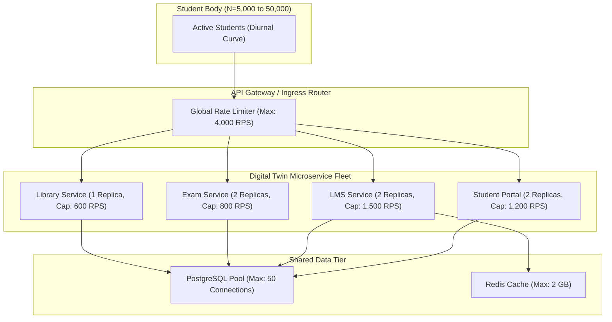
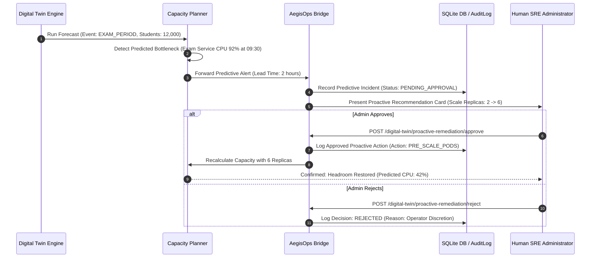

# UniMind AI + AegisOps: Digital Twin Campus Simulation Engine Architecture

**Document Version:** 1.0.0  
**Milestone:** Stage E — Enterprise Intelligence & Predictive Capacity Planning  
**Target Environment:** Localhost / Modular Monolith (8 GB Host RAM, zero cloud costs)  

---

## 1. Executive Summary & Purpose

The **Digital Twin Campus Simulation Engine** is a high-fidelity, deterministic operational simulation and predictive capacity planning platform designed for higher education IT infrastructure. 

Modern universities experience extreme, non-linear traffic shifts:
- Routine diurnal diurnal cycles (lecture attendance check-ins, campus Wi-Fi shifts).
- High-intensity assignment deadlines (massive traffic concentration between 22:00 and 23:59).
- Synchronous examination windows (burst authentication, stateful test submissions).
- Concurrency shock events (e.g., semester result announcements).

Traditional SRE monitoring is **reactive**: alerts fire *after* a database connection pool is exhausted or a pod is CPU throttled. The Digital Twin models campus human dynamics (students, faculty, applicants) alongside infrastructure capacity limits (service throughput, container replicas, Postgres connection pools) to generate **predictive early-warning alerts and proactive remediation recommendations** hours before operational degradation occurs.

---

## 2. Diurnal Student Activity & Traffic Modeling

### 2.1 Diurnal Activity Curve ($A(t)$)
Campus student activity over a 24-hour cycle $t \in [0, 23]$ follows a multi-modal distribution characterized by:
1. **Dormant Night (01:00 - 06:00)**: Nominal background activity ($\sim 2\% - 5\%$ of student body active).
2. **Morning Class Influx (08:00 - 11:00)**: Sharp arrival surge for lecture attendance check-ins and timetable lookup.
3. **Midday Academic Plateau (12:00 - 16:00)**: Steady LMS downloads, campus portal queries, and library catalog searches.
4. **Evening Study & Submission Peak (19:00 - 23:00)**: Heaviest asynchronous access, forum activity, and pre-midnight deadline rushes.

The baseline hourly activity coefficient $C_{base}(t)$ is defined as:
$$C_{base}(t) = \begin{cases}
0.03, & 0 \le t \le 5 \\
0.12, & t = 6, 7 \\
0.55, & 8 \le t \le 11 \\
0.65, & 12 \le t \le 16 \\
0.45, & 17 \le t \le 18 \\
0.85, & 19 \le t \le 22 \\
0.40, & t = 23
\end{cases}$$

### 2.2 Academic Calendar Events Modifier ($M_{event}(s, t)$)
Different academic events apply non-linear multiplier functions across specific campus services $s \in \{\text{portal}, \text{lms}, \text{exam}, \text{library}\}$:

| Academic Event | Target Service Primary Impact | Concurrency Multiplier | Peak Window | Traffic Behavior |
| :--- | :--- | :---: | :---: | :--- |
| `NORMAL_DAY` | Balanced across all services | $1.0\times$ | 14:00 & 20:00 | Standard diurnal cycle. |
| `EXAM_PERIOD` | `exam_service` | $4.5\times - 8.0\times$ | 09:00 - 12:00 & 14:00 - 17:00 | Synchronous, high-concurrency, stateful DB writes. |
| `ASSIGNMENT_DEADLINE` | `lms` | $3.5\times - 6.0\times$ | 21:00 - 23:59 | File uploads, grading worker queue saturation. |
| `ADMISSION_PERIOD` | `student_portal` | $2.5\times - 4.0\times$ | 10:00 - 18:00 | Read-heavy public brochure downloads, registration. |
| `RESULT_ANNOUNCEMENT` | `student_portal` & `exam_service` | $8.0\times - 12.0\times$ | Instantaneous spike | Read-after-write burst, DB connection pool contention. |

Total concurrent active students at hour $t$ for event $E$ is given by:
$$U_{concurrent}(t) = N_{students} \times C_{base}(t) \times M_{intensity} \times E_{modifier}(t)$$

---

## 3. Infrastructure Digital Twin Specification

Each microservice in the university fleet is modeled with defined nominal and saturation limits:

### 3.1 Service Capacity & Resource Consumption Models

For each service $s$, request rate $\lambda_s(t)$ (requests per second) is derived from concurrent users:
$$\lambda_s(t) = U_{concurrent}(t) \times r_{req\_per\_user} \times W_{service\_weight}(s)$$

Resource consumption is estimated via calibrated regression models:
1. **CPU Utilization**:
   $$\text{CPU}_s(t) = \text{CPU}_{base} + \left( \frac{\lambda_s(t)}{\text{Capacity}_{max}(s)} \right)^{1.35} \times 70\%$$
   *Exponential factor $1.35$ reflects non-linear context switching and GC overhead under high load.*
2. **Memory Utilization**:
   $$\text{Mem}_s(t) = \text{Mem}_{base} + \left( \frac{U_{concurrent}(t)}{U_{threshold}} \right) \times 35\%$$
3. **Database Connection Pool Saturation**:
   $$Conn_{active}(t) = Conn_{idle} + \sum_{s} \left( \lambda_s(t) \times t_{query\_latency}(s) \right)$$
   $$\text{Pool Saturation } \% = \min\left(100\%, \frac{Conn_{active}(t)}{Conn_{max}} \times 100\right)$$

---

## 4. Predictive Capacity Planning & Bottleneck Detection

The predictive capacity planner evaluates simulated time-series against SRE safety thresholds:

| Metric | Warning Threshold | Critical Threshold | Predicted Failure Mode |
| :--- | :---: | :---: | :--- |
| **CPU Utilization** | $\ge 75\%$ | $\ge 85\%$ | CFS CPU quota throttling, request queuing. |
| **Memory Utilization**| $\ge 80\%$ | $\ge 90\%$ | Container cgroup OOM kill risk. |
| **DB Pool Saturation**| $\ge 75\%$ | $\ge 88\%$ | Connection checkout timeout (`503 Service Unavailable`). |
| **Request Latency** | $\ge 400\text{ ms}$ | $\ge 800\text{ ms}$ | HTTP client timeout, cascading retry storm. |

When a metric exceeds warning thresholds, the engine registers a **Bottleneck Forecast**:
- Identifies exact predicted timestamp of saturation.
- Quantifies headroom deficiency (e.g., "Predicted 1,240 RPS exceeds Exam Service 800 RPS capacity by 55%").
- Correlates with the driving academic event.

---

## 5. Proactive AegisOps Integration & Human-in-the-Loop Workflow

Unlike reactive chaos self-healing, the Digital Twin connects to AegisOps as an **Early-Warning Advisor**:

### 5.1 Strict Human-in-the-Loop Safety Rule
**No autonomous infrastructure scaling or pod termination occurs without explicit human approval.** The Digital Twin provides the forecast, blast-radius calculation, and recommended configuration. The SRE administrator retains final authority.

---

## 6. Data Provenance & Operational Footprint

1. **Explicit Simulation Tagging**:
   - Every metric, time series, and forecast produced by the Digital Twin carries metadata:
     `{"is_simulation": true, "data_source": "digital_twin_engine", "model_version": "1.0.0"}`.
   - Prevents mixing synthetic future projections with genuine operational Prometheus metrics.
2. **Resource Footprint**:
   - Implemented in standard Python (`math`, `numpy`, `pydantic`).
   - Zero additional memory resident daemons; executes simulations on-demand in $<100\text{ ms}$.
   - Memory overhead $<50\text{ MB}$, well within the 8 GB host constraints.

