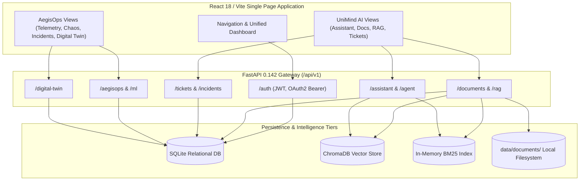

# UniMind AI + AegisOps: Stage F Multi-Tenant Enterprise Architecture & Security Audit

**Document Version:** 1.0.0  
**Phase:** Development Phase F0 — Architecture & Security Audit  
**Author:** Antigravity / Engineering Architecture  
**Target Platform:** Reusable Multi-Tenant Enterprise AI & Operations Engine  
**Hardware Environment:** Localhost (Intel Core i5-12450H, 8 GB RAM, Windows 11, SQLite/ChromaDB)  
**Current Baseline Status:** 50/50 Automated Tests Passing, 20/20 Live Verification Checks Passing  

---

## 1. Current Architecture Assessment

The existing platform is structured as a clean **modular monolith** optimized for academic operations:

### Strengths:
1. **Strong Separation of Concerns**: Modular routing across RAG, LLM clients, ML Isolation Forest, and Digital Twin.
2. **Deterministic & Lightweight**: Zero external cloud cost, low CPU footprint, executes comfortably within the 8 GB host RAM constraint.
3. **Rigorous Test Coverage**: 50 automated tests covering unit logic, failure injection, incident lifecycles, and student activity simulation.

---

## 2. Multi-Tenancy Gap Analysis

A comprehensive audit of the repository reveals that the existing platform was designed around a **single university organization**. The following architectural gaps prevent immediate multi-tenant enterprise deployment:

| Subsystem | Existing State | Enterprise Multi-Tenant Requirement | Risk Level |
| :--- | :--- | :--- | :---: |
| **Organization Model** | None. Single hardcoded university persona. | `Organization` / `Tenant` entity with slug, industry, configuration, status (`ACTIVE`, `SUSPENDED`). | **CRITICAL** |
| **User Identity & Scoping** | `User` has `role` (`STUDENT`, `FACULTY`, `ADMIN`), but no `tenant_id` or organization relationship. | Users must belong to an organization. Universal roles (`OWNER`, `ADMIN`, `MEMBER`, `AUDITOR`) with industry aliases. | **CRITICAL** |
| **Database Scoping** | Tables (`documents`, `conversations`, `messages`, `tickets`, `incidents`, `audit_logs`) lack `tenant_id`. | Mandatory `tenant_id` foreign key on all enterprise resources. Enforced at query level. | **CRITICAL** |
| **Vector Store (ChromaDB)**| Single shared collection: `university_knowledge_base`. No tenant metadata filter in embeddings. | Multi-collection per tenant (e.g. `tenant_{id}_kb`) OR strict mandatory `{"tenant_id": ...}` metadata filtering. | **CRITICAL** |
| **Lexical Search (BM25)** | Single in-memory global singleton index (`_global_bm25_index`). | Tenant-partitioned BM25 index dictionary: `Dict[str, BM25Index]`. | **CRITICAL** |
| **Document Storage** | Flat filesystem: `data/documents/<category>/<filename>`. Filename collisions across companies. | Isolated filesystem path: `data/tenants/<tenant_id>/documents/<category>/<filename>`. | **HIGH** |
| **Context Propagation** | JWT contains only user identity `sub`. API endpoints do not extract or propagate tenant context. | JWT includes `tenant_id` claim; request dependency `get_current_tenant` enforces tenant context. | **CRITICAL** |
| **Enterprise Control Plane** | Missing. No platform admin API to provision, configure, or suspend tenants. | Super-Admin / Platform Admin control plane for tenant lifecycle, branding, and billing limits. | **HIGH** |
| **Industry Configurations** | Hardcoded university categories (`hostel`, `examinations`, `attendance`). | Reusable schema: healthcare, banking, IT, manufacturing templates configurable per tenant. | **MEDIUM** |

---

## 3. Data Isolation Threat Model (STRIDE)

| Threat Category | Specific Attack Vector in Current Codebase | Exploitation Scenario | Mitigation Strategy |
| :--- | :--- | :--- | :--- |
| **Spoofing** | Attacker passes forged `tenant_id` header or body parameter. | An authenticated user from Hospital A submits requests with `?tenant_id=bank_b`. | Never trust client-supplied tenant ID. Derive `tenant_id` exclusively from cryptographically verified JWT session. |
| **Tampering** | Path traversal in file storage `save_uploaded_file`. | Malicious file upload overwrites another tenant's policies. | Enforce sandboxed tenant directory roots (`data/tenants/<tenant_id>/...`) with filename sanitization. |
| **Repudiation** | Audit logs lack tenant scoping. | An SRE admin executes actions, but audit records cannot be filtered or proven per company. | Every `AuditLog` row must record `tenant_id`, `actor_role`, and SHA-256 integrity hash. |
| **Information Disclosure** | Cross-tenant RAG search leakage. | A student queries *"Show executive salary data"*; retriever searches global ChromaDB and leaks corporate docs. | Strict collection-level partitioning and mandatory ChromaDB + BM25 `where={"tenant_id": current_tenant.id}` filters. |
| **Elevation of Privilege** | Platform admin vs Tenant admin role confusion. | Tenant Admin promotes themselves to global cluster operator. | Strict hierarchical RBAC: `PLATFORM_ADMIN` $\ne$ `TENANT_ADMIN`. Platform endpoints isolated under `/api/v1/platform`. |
| **Denial of Service** | Rogue tenant exhausts shared DB connection pool or memory. | One tenant triggers massive 50,000-user simulation and saturates server. | Tenant-level quota enforcement on document storage, concurrent users, and rate limits. |

---

## 4. Database Migration & Schema Design Plan

### 4.1 New Tables
1. **`organizations` (Tenants)**:
   - `id`: Integer PK
   - `slug`: String(50), Unique Index (e.g. `unimind-edu`, `apollo-health`, `fintech-corp`)
   - `name`: String(255)
   - `industry`: String(50) (e.g. `EDUCATION`, `HEALTHCARE`, `FINANCE`, `TECHNOLOGY`, `MANUFACTURING`, `LOGISTICS`)
   - `status`: String(20) (`ACTIVE`, `SUSPENDED`, `ONBOARDING`)
   - `config`: JSON (branding, categories, quota limits, AI prompt instructions)
   - `created_at`, `updated_at`: DateTime

2. **`organization_memberships`**:
   - `id`: Integer PK
   - `tenant_id`: Integer FK -> `organizations.id`
   - `user_id`: Integer FK -> `users.id`
   - `role`: String(50) (`OWNER`, `ADMIN`, `MEMBER`, `GUEST`)
   - `is_active`: Boolean
   - `joined_at`: DateTime

### 4.2 Schema Enhancements (Preserving Existing Data)
Add `tenant_id` foreign key (with default mapping to initial tenant `1: UniMind University`) to:
- `users.tenant_id`
- `documents.tenant_id`
- `conversations.tenant_id`
- `tickets.tenant_id`
- `incidents.tenant_id`
- `audit_logs.tenant_id`

### 4.3 Zero-Downtime Data Migration
- Migration script creates the default organization:
  `Organization(id=1, slug="unimind-edu", name="UniMind University", industry="EDUCATION")`.
- Existing users (`admin`, `student`), documents, tickets, and incidents are automatically backfilled with `tenant_id = 1`.
- Existing tests and live verification scenarios remain 100% operational without data loss.

---

## 5. API Modification Plan

### 5.1 Context Dependency Architecture
Create `backend/app/api/tenant_deps.py`:
- `get_current_tenant(db, current_user)`: Extracts `tenant_id` from user's active membership or JWT claims.
- `require_tenant_roles(*roles)`: Verifies role within the caller's specific tenant.
- `require_platform_admin`: Verifies caller is a global platform operator.

### 5.2 Endpoint Scoping
1. **Documents (`/documents`)**:
   - `POST /upload`: saves to `data/tenants/{tenant_id}/documents/{category}/...`, records `tenant_id`.
   - `GET /`: returns documents filtered by `Document.tenant_id == current_tenant.id`.
2. **RAG (`/rag`)**:
   - `POST /ingest/{doc_id}`: indexes chunks tagged with `tenant_id`.
   - `POST /query`: queries ChromaDB and BM25 scoped strictly to `tenant_id`.
3. **Assistant (`/assistant`)**:
   - `POST /chat`: passes `tenant_id` to `search_knowledge_base`, formats answers using tenant's system persona and knowledge base.
4. **Tickets & Incidents (`/tickets`, `/incidents`)**:
   - Filter all queries by `tenant_id == current_tenant.id`.
5. **Platform Administration (`/platform`)**:
   - `POST /platform/tenants`: provision new organization.
   - `GET  /platform/tenants`: list organizations and usage statistics.
   - `PATCH /platform/tenants/{id}/status`: activate / suspend organization.
   - `PUT  /platform/tenants/{id}/config`: update tenant branding and categories.

---

## 6. Tenant-Isolated AI & Knowledge Architecture

### 6.1 Vector Isolation (ChromaDB)
Instead of putting all tenants into a single collection with risk of metadata filter bypass:
- Use **Tenant-Dedicated Collections**: `tenant_{tenant_id}_kb`
- In addition, enforce `where={"tenant_id": tenant_id}` inside metadata as defense-in-depth.
- Isolation is physically enforced at the collection directory level within `./data/chroma`.

### 6.2 Lexical Isolation (BM25)
- Replace global singleton `_global_bm25_index` with a **Tenant Registry**:
  `_tenant_bm25_registry: Dict[int, BM25Index] = {}`
- `get_tenant_bm25_index(tenant_id: int) -> BM25Index`: lazily initializes and synchronizes the index strictly from that tenant's vector collection.
- Cross-tenant token leakage is strictly impossible in memory.

---

## 7. Performance & Reliability Optimization Plan (8 GB Host RAM)

1. **Lightweight Partitioning**:
   - SQLite handles multi-tenant indexing cleanly via indexed compound columns: `INDEX idx_docs_tenant_cat (tenant_id, category)`.
   - In-memory BM25 indexes are instantiated per-tenant on demand; empty tenants consume 0 bytes.
2. **Shared SentenceTransformer Embedding Engine**:
   - The embedding model (`all-MiniLM-L6-v2`) is loaded **once** as a shared singleton in memory ($\sim 80\text{ MB}$ footprint).
   - Ingestion and query embeddings pass through the same model with zero redundant memory allocations.
3. **ChromaDB Client Re-use**:
   - Single `PersistentClient` instance manages multiple collections without spawning new daemon processes.
4. **Memory Guard**:
   - Digital Twin and Chaos simulation modules execute within the tenant's CPU/memory quotas, guaranteeing total runtime memory remains $<650\text{ MB}$.

---

## 8. Proposed Phased Implementation Sequence

```mermaid
flowchart LR
    F0["F0: Audit & Plan (Done)"] --> F1["F1: Tenant Foundation & DB Migration"]
    F1 --> F2["F2: Multi-Tenant Auth & RBAC"]
    F2 --> F3["F3: Tenant-Isolated AI & RAG"]
    F3 --> F4["F4: Enterprise Control Plane"]
    F4 --> F5["F5: Company Templates (Edu, Health, Fin)"]
    F5 --> F6["F6: Cross-Tenant Security Tests"]
    F6 --> F7["F7: Final Report & Verification"]
```

- **Phase F1**: Organization model, membership model, database migration, context propagation middleware.
- **Phase F2**: Identity & access management (Tenant Admin, Member, compatible Student/Faculty mappings).
- **Phase F3**: Partitioned ChromaDB collections, tenant BM25 registry, isolated RAG retrieval & Assistant.
- **Phase F4**: Enterprise Control Plane (tenant provisioning, configuration, usage stats).
- **Phase F5**: Multi-industry configuration templates (University, Healthcare, Banking, Technology).
- **Phase F6**: Automated cross-tenant penetration and regression test suite (verifying zero cross-tenant leakage).
- **Phase F7**: Full regression suite (50+ tests), live verification, and Final Stage F Engineering Report.

