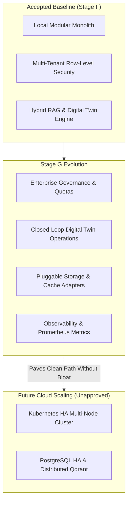
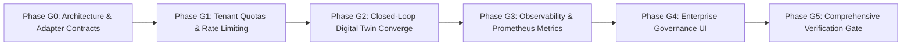

# Stage G Milestone Proposal: Enterprise Governance, Closed-Loop Operations & Pluggable Infrastructure Adapters
**Platform:** UniMind AI + AegisOps Enterprise Platform  
**Target Milestone:** Stage G  
**Current Baseline:** Stage F Formally Accepted (Git HEAD: `ea6d1ef...`, 56/56 Tests Passing, Memory: 516.89 MB)  
**Proposed By:** Antigravity AI Engineering Team  
**Review Status:** **PENDING USER AUTHORIZATION (NO CODE MODIFIED)**

---

## 1. Executive Summary & Purpose

With Stage F formally accepted for the local modular monolith, development, single-host staging, and controlled pilot deployment scope, the platform possesses proven multi-tenancy, cross-tenant security isolation, hybrid RAG retrieval, and AI-driven autonomous incident remediation.

**Stage G** addresses the logical next evolution: transitioning from a single-node pilot to an **enterprise-governed, closed-loop operational platform** while establishing **pluggable infrastructure abstractions** that prepare the codebase for future horizontal cloud scaling without requiring heavy distributed infrastructure during local development.

---

## 2. Core Milestone Objectives

### Objective 1: Pluggable Infrastructure Abstraction Layer (Zero-Bloat Cloud-Ready Architecture)
- Design clean **Storage**, **Vector Store**, **Cache/Queue**, and **Identity** adapter interfaces.
- Decouple the FastAPI application layer from concrete SQLite and local ChromaDB implementations.
- Provide zero-dependency local defaults (SQLite, local ChromaDB, in-process queues) while defining drop-in adapter contracts for enterprise external backends (PostgreSQL 16+, Qdrant/Milvus, Redis 7+, S3/MinIO).
- Guarantee that the local development environment runs without running Docker or cloud services.

### Objective 2: Enterprise Governance, Tenant Quotas & Metering
- Implement per-tenant resource governance to prevent "noisy neighbor" resource starvation.
- **Token Bucket Rate Limiting:** Enforce configurable request rate limits per tenant (e.g., 60 req/min for Free/Pilot, 1000 req/min for Enterprise) returning `HTTP 429 Too Many Requests`.
- **RAG & Document Storage Quotas:** Enforce maximum document storage caps (e.g., 50 MB for pilot tenants) and maximum monthly token usage tracking.
- **Audit Log Export:** Provide tenant administrators with cryptographically verifiable audit log export endpoints (JSON-Lines / CSV) with date-range filtering.

### Objective 3: Closed-Loop Digital Twin & AegisOps Operational Convergence
- Bridge predictive Digital Twin simulation outputs directly into AegisOps autonomous incident workflows.
- When Digital Twin simulations detect an impending resource exhaustion or energy surge (e.g., predicted server room HVAC failure or registration portal traffic surge):
  - Automatically instantiate an AegisOps proactive incident ticket.
  - Suggest pre-approved remediation playbooks (e.g., load shed non-critical services, pre-scale worker instances, dynamic cache warming).
  - Enforce human-in-the-loop operator approval before any physical or infrastructure actuator is invoked.

### Objective 4: Production Observability, Metrics & Health Probing
- Implement a standard Prometheus `/metrics` endpoint exposing:
  - `unimind_http_requests_total` (partitioned by method, route, tenant_id, status_code).
  - `unimind_request_duration_seconds` (p50, p90, p99 latency histograms).
  - `unimind_rag_retrieval_latency_ms` (dense, sparse, fusion breakdown).
  - `aegisops_telemetry_anomaly_score` (gauge tracking real-time ML anomaly scores).
  - `digital_twin_energy_consumption_kwh` and `occupancy_ratio`.
- Standardize Kubernetes/Docker health probes: `/health/live` (process alive) and `/health/ready` (database and model initialized).

---

## 3. Strict Operating Rules & Hardware Boundaries

To adhere strictly to user constraints and local hardware limits:
1. **8 GB RAM Hardware Budget:**
   - Peak application RAM must not exceed **750 MB** (leaving >7.2 GB for the OS and IDE).
   - No mandatory background Docker containers or external cloud databases required for test suites.
2. **Preservation of Verified Code:**
   - All 56 existing regression tests, 14 cross-tenant security probes, and 8 smoke tests must continue to pass with 100% integrity.
   - The verified 5-feature Isolation Forest model (`c2715221...`) must remain untouched.
3. **No Unapproved Distributed Deployments:**
   - Multi-node Kubernetes clusters, external PostgreSQL clusters, and distributed Redis brokers remain strictly **unapproved**; only local adapter interfaces and contracts will be authored.

---

## 4. Proposed Implementation Phases

### Phase G0 — Architecture & Interface Contracts
- Define abstract base classes:
  - `StorageAdapter` (`backend/app/adapters/storage.py`)
  - `VectorDatabaseAdapter` (`backend/app/adapters/vector.py`)
  - `CacheQueueAdapter` (`backend/app/adapters/cache.py`)
- Implement SQLite, local ChromaDB, and local asyncio adapters honoring these interfaces.
- Deliver architecture documentation: `docs/STAGE_G_ARCHITECTURE_DESIGN.md`.

### Phase G1 — Enterprise Governance, Rate Limiting & Metering
- Implement in-memory token-bucket rate limiter middleware keyed by `tenant_id`.
- Add tenant quota columns (`max_documents`, `max_storage_bytes`, `monthly_token_budget`) to `tenants` table.
- Build audit log export service supporting CSV/JSONL formats with tenant isolation.
- Add unit tests for quota enforcement and `HTTP 429` rejection.

### Phase G2 — Closed-Loop Digital Twin & AegisOps Operational Convergence
- Implement alert dispatch bridge between `DigitalTwinSimulationEngine` and `AegisOpsIncidentManager`.
- Define proactive incident types (`PREDICTIVE_ENERGY_ANOMALY`, `PREDICTED_CAPACITY_EXHAUSTION`).
- Implement human-in-the-loop approval endpoint for proactive mitigations (`POST /api/v1/aegisops/remediations/{id}/approve`).

### Phase G3 — Production Observability & Standardized Metrics
- Integrate `prometheus-client` to collect RED metrics (Rate, Errors, Duration).
- Instrument FastAPI middleware to record Prometheus metrics per tenant without high-cardinality leakage.
- Expose `/health/live`, `/health/ready`, and `/metrics`.

### Phase G4 — Frontend Enterprise Governance Dashboard
- Extend `MultiTenantAdminDashboard.tsx` with:
  - Tenant quota sliders and live utilization gauges (storage, token usage, rate limits).
  - Audit log download button with date filters.
  - Closed-loop Digital Twin proactive alert notifications.
- Ensure 0 build errors in Vite production compilation.

### Phase G5 — Comprehensive Verification & Independent Evidence Collection
- Expand test suite to **70+ tests** covering rate limiting, quotas, closed-loop triggers, and metrics.
- Re-run full 14-probe security audit.
- Re-verify 5-feature ML model hash and SQLite database integrity.
- Deliver consolidated Stage G acceptance package.

---

## 5. Dependencies & Technical Risk Assessment

| Risk Item | Impact | Probability | Mitigation Strategy |
| :--- | :---: | :---: | :--- |
| **Memory footprint exceeds 8 GB limit** | High | Low | Use in-memory algorithms (token bucket, lightweight gauges) without external daemon processes. |
| **Refactoring to adapters breaks Stage F multi-tenancy** | Critical | Low | Maintain existing `tenant_deps.py` contracts; wrap existing tested code rather than rewriting it. |
| **High cardinality in Prometheus metrics** | Medium | Medium | Bound label dimensions: only record `method`, `route_template`, and `status_family` (2xx, 4xx, 5xx); sanitize tenant IDs. |
| **Autonomous actuators executing unsafe operations** | High | Low | Enforce explicit `PENDING_APPROVAL` status; physical simulation actuators require administrator JWT approval. |

---

## 6. Target Acceptance Criteria for Stage G

To achieve formal acceptance upon milestone completion, Stage G must satisfy:
1. **Automated Test Suite:** $\ge 70$ passing tests (100% pass rate, zero skips).
2. **Cross-Tenant Security:** 100% pass across all 14 existing security checks plus new cross-tenant quota isolation checks.
3. **Governance & Quotas:**
   - Over-limit requests return `HTTP 429 Too Many Requests` with `Retry-After` headers.
   - Storage cap enforcement blocks uploads when quota is exceeded with `HTTP 413 Payload Too Large`.
4. **Closed-Loop Operations:** Digital Twin simulation alerts trigger AegisOps proactive incidents with verified state transitions.
5. **Observability:** `/metrics` returns valid Prometheus exposition format containing HTTP latency histograms and anomaly scores.
6. **Hardware Footprint:** Peak RAM $\le 750$ MB on the 8 GB development workstation.
7. **Zero Architecture Breakage:** Single-node modular monolith remains fully self-contained with zero mandatory external services.

---

## 7. Recommendation & Authorization Request

We recommend approving **Stage G — Enterprise Governance, Closed-Loop Operations & Pluggable Infrastructure Adapters** under the strict constraint that:
- Implementation will not begin until explicit user authorization is provided.
- The existing Stage F baseline code remains untouched and preserved.

*Please review this proposal and indicate whether you approve proceeding with Phase G0 of Stage G.*
