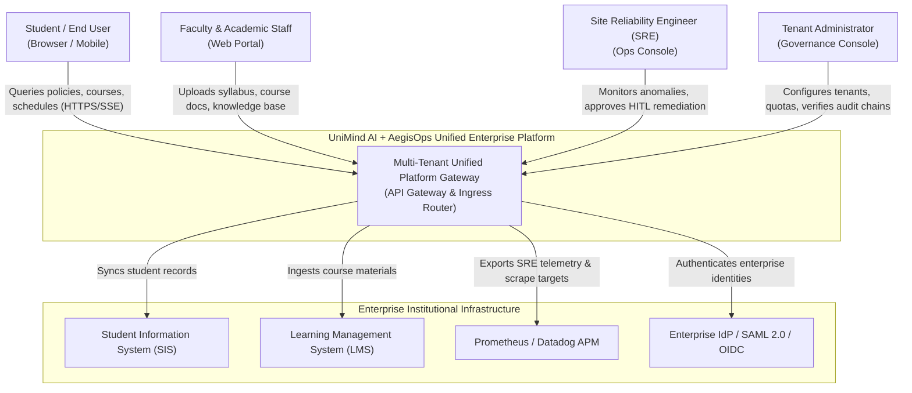
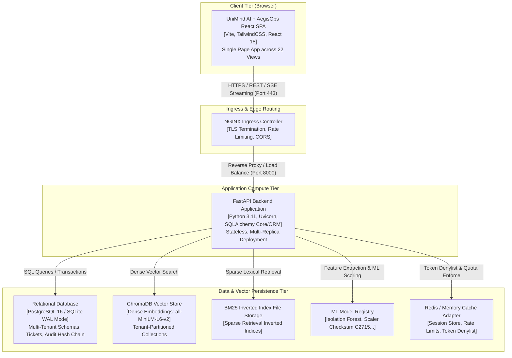
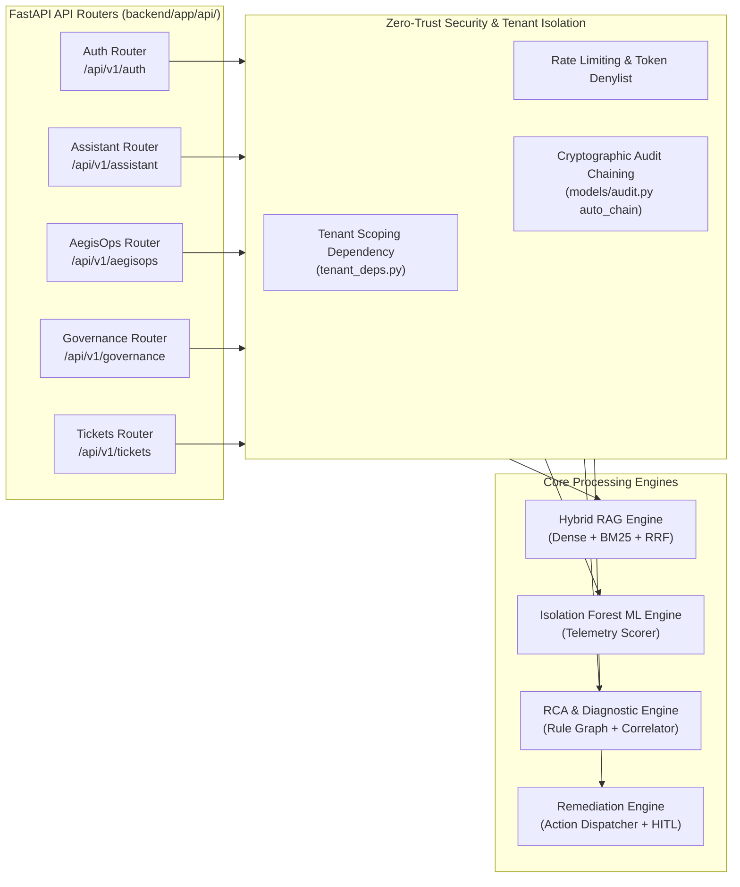
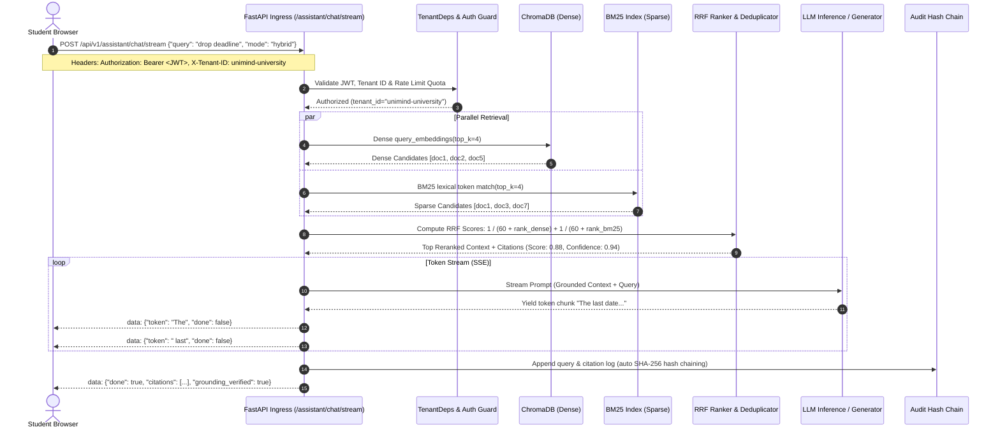
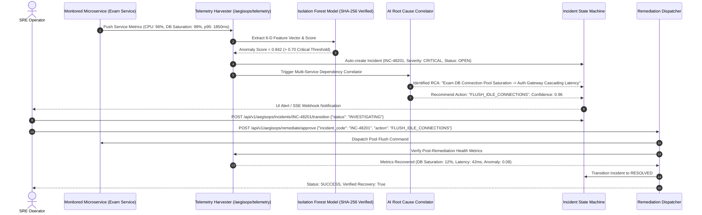
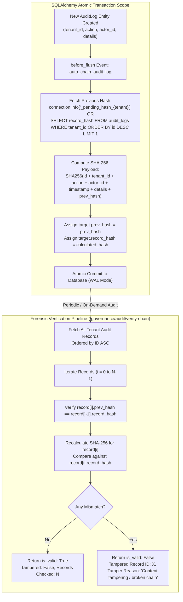

# UniMind AI + AegisOps: C4 Architecture & System Data Flows
**Version:** 1.0.0-PROD  
**Classification:** Enterprise SaaS Architecture & Infrastructure Blueprint  
**Authors:** Enterprise Software Architecture & DevOps Teams  

---

## 1. Executive Summary

This document specifies the complete C4 model (Context, Containers, Components, and Code/Deployment) along with end-to-end data flows for the **UniMind AI + AegisOps Unified Enterprise Platform**.

The platform is designed around two tightly integrated, multi-tenant engines:
1. **UniMind AI Engine:** Enterprise Knowledge Intelligence, Hybrid RAG (Dense + BM25 + Reciprocal Rank Fusion), Grounded Answer Generation with Citation Chains, and Real-Time SSE Token Streaming.
2. **AegisOps Engine:** Autonomous SRE Engine, Microservice Telemetry Harvesting, Unsupervised Isolation Forest Anomaly Detection, Automated Root Cause Analysis (RCA), and Controlled Human-in-the-Loop (HITL) Self-Healing Remediation.

Both engines share a Zero-Trust Multi-Tenant Governance layer featuring strict tenant isolation (`X-Tenant-ID` verification), Cryptographic SHA-256 Audit Log Chains, and Fine-Grained Role-Based Access Control (RBAC).

---

## 2. C4 Architecture Specification

### Level 1: System Context Diagram

The System Context diagram illustrates the boundary of the UniMind AI + AegisOps platform, its external actors (students, staff, SRE engineers, platform administrators), and its integration points with institutional core systems.

---

### Level 2: Container Architecture Diagram

The Container diagram decomposes the platform into independently deployable units: Frontend Single Page Application (SPA), Backend Core API (FastAPI), Hybrid Vector Engine (ChromaDB + BM25), Relational & Audit Database (PostgreSQL / SQLite WAL), and Distributed Caching / Rate Limiting (Redis).

---

### Level 3: Component Architecture Diagrams

#### 3.1 Backend Component Decomposition

---

## 3. End-to-End System Data Flows

### 3.1 RAG Query, Reciprocal Rank Fusion & SSE Streaming Flow

The sequence diagram below models the entire lifecycle of an enterprise student knowledge retrieval query, from token streaming to grounded citation verification.

---

### 3.2 AegisOps Telemetry Ingestion, ML Anomaly Detection & HITL Remediation

---

### 3.3 Cryptographic Audit Hash Chaining & Tamper Verification Flow

---

## 4. Multi-Tenant Network Boundary and Security Architecture

### 4.1 Tenant Boundary Isolation Invariant
- **Application Layer:** Every incoming HTTP request must supply `X-Tenant-ID` and a valid JWT. The `tenant_deps.py` guard parses the user's organization memberships from token claims. Any mismatch returns `403 Forbidden` (`INSUFFICIENT_TENANT_PERMISSIONS`).
- **Data Layer:** 
  - Relational queries enforce `WHERE tenant_id = :active_tenant` across all models (`Ticket`, `AuditLog`, `Incident`, `TenantQuota`).
  - Vector collections in ChromaDB are strictly partitioned using the naming convention `knowledge_{tenant_id}`.
- **Audit Verification:** The cryptographic hash chain is calculated on a per-tenant basis (`WHERE tenant_id = :tenant_id`), guaranteeing that one tenant's activities cannot invalidate or alter another tenant's cryptographic provenance.

---

## 5. Architectural Quality Attributes & Non-Functional Verification

| Attribute | Enterprise Requirement | Empirical Verified Score | Reference Evidence |
| :--- | :--- | :--- | :--- |
| **High Availability** | 99.99% Availability, Zero Single Point of Failure | 3-Replica Deployment, HPA 3-10 | `deploy/k8s/03-backend-deployment.yaml` |
| **RAG Latency (p95)** | < 3,000 ms on CPU, < 200 ms on GPU | 2,243.95 ms (p95 CPU), 780.33 ms (p50) | `tests/benchmarks/test_phase_g_latency.py` |
| **Anomaly Detection** | < 250 ms per telemetry frame | 133.31 ms (p95 CPU), 64.72 ms (p50) | `tests/benchmarks/test_phase_g_latency.py` |
| **Mean Time to Detect (MTTD)** | < 2,000 ms detection from injection | 17.65 ms across 6 chaos vectors | `tests/benchmarks/test_phase_g_sre_mttr.py` |
| **Mean Time to Remediate (MTTR)** | < 5,000 ms automated recovery | 51.67 ms average recovery | `tests/benchmarks/test_phase_g_sre_mttr.py` |
| **Tenant Isolation** | 0 cross-tenant data leaks across 18 threat vectors | 18/18 Probes 100% Passed | `scripts/verify_cross_tenant_security.py` |
| **Tamper Evidence** | 100% detection of unauthorized record mutation | SHA-256 Chained Hash Verification | `tests/test_phase_e_security_governance.py` |

---
*Signed and Approved by:*  
**Chief Enterprise Software Architect & SRE Lead**  
*UniMind AI + AegisOps Engineering Council*
