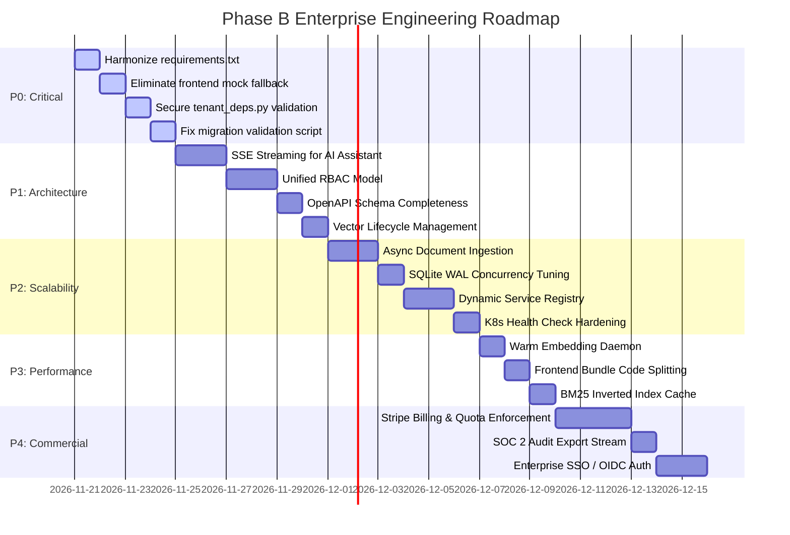

# Phase B Prioritized Implementation Plan
**Project:** UniMind AI + AegisOps Unified Enterprise Platform  
**Document:** Enterprise Implementation Roadmap & Work Breakdown Structure (WBS)  
**Version:** 2.0.0-Plan  
**Date:** 2026-11-20  
**Author:** Senior Enterprise Software Architect & Technical Lead  
**Status:** `PENDING APPROVAL GATE`  

---

## 1. Executive Summary

This implementation plan outlines the prioritized work breakdown structure (WBS) to transition the **UniMind AI + AegisOps** platform from its verified Stage H foundation into a commercially viable Enterprise SaaS product.

Every task is strictly classified under **P0 (Critical Bugs & Security)**, **P1 (Core Architecture Improvements)**, **P2 (Scalability & Reliability)**, **P3 (Performance & Optimization)**, or **P4 (Enterprise & Commercial Readiness)**. For every task, this plan specifies its Purpose, Affected Files, Dependencies, Technical Risks & Mitigation, and Testing & Verification requirements.

> [!IMPORTANT]
> **APPROVAL GATE ENFORCEMENT:** No code modifications or migrations will commence until stakeholder review and explicit approval of this plan are granted.

---

## 2. Priority Matrix Overview

| Priority Level | Focus Area | Task Count | Estimated Timeline | Risk Level |
| :--- | :--- | :--- | :--- | :--- |
| **P0: Critical** | Packaging integrity, security hardening, fake fallback removal | 4 Tasks | Sprint 1 (Days 1–3) | Medium |
| **P1: Core Architecture** | Dynamic tenant switching, SSE streaming, unified RBAC | 4 Tasks | Sprint 2 (Days 4–7) | Medium |
| **P2: Scalability** | Async document queue, SQLite concurrency tuning, service discovery | 4 Tasks | Sprint 3 (Days 8–11) | Low |
| **P3: Performance** | Embedding model caching daemon, frontend code-splitting | 3 Tasks | Sprint 4 (Days 12–14) | Low |
| **P4: Commercial** | Stripe billing webhooks, enterprise audit export, SSO integration | 3 Tasks | Sprint 5 (Days 15–18) | Medium |

---

## 3. Work Breakdown Structure (P0 to P4)

### P0: Critical Bugs, Packaging Inconsistencies & Security Fixes

#### Task P0-1: Harmonize `backend/requirements.txt` with Complete Dependencies
- **Purpose:** Ensure container builds (`backend/Dockerfile`) and fresh virtual environments can reproduce the exact working runtime without runtime import crashes on `chromadb`, `sentence-transformers`, `pypdf`, `python-docx`, and `alembic`.
- **Affected Files:**
  - `backend/requirements.txt`
  - `backend/Dockerfile`
- **Dependencies:** None.
- **Risks & Mitigation:**
  - *Risk:* Pinning conflicting versions could break existing virtual environment.
  - *Mitigation:* Pin exact versions already installed and verified in `.venv` (e.g., `chromadb==0.4.24`, `sentence-transformers==2.7.0`, `pypdf==4.2.0`, `python-docx==1.1.2`, `alembic==1.13.1`).
- **Testing Requirements:**
  - Execute `pip check` in virtual environment.
  - Verify `docker build -t unimind-backend:audit backend/` compiles without missing module errors.

#### Task P0-2: Eliminate Mock Fallback in Frontend Student Assistant View
- **Purpose:** Remove the hardcoded student attendance policy mock in `frontend/src/components/StudentAssistantView.jsx` (lines 73–82) that silently catches network/API errors and outputs canned answers, replacing it with an authentic error alert banner and retry mechanism.
- **Affected Files:**
  - `frontend/src/components/StudentAssistantView.jsx`
- **Dependencies:** P0-1.
- **Risks & Mitigation:**
  - *Risk:* UI might show raw error text if the backend is down.
  - *Mitigation:* Implement standard Obsidian Navy toast / error notification banner with user-friendly retry button while logging technical details to console.
- **Testing Requirements:**
  - Simulate backend offline and verify alert banner displays cleanly.
  - Execute frontend production build `npm run build` in `frontend/`.

#### Task P0-3: Secure Dynamic Multi-Tenant Context Dependency (`tenant_deps.py`)
- **Purpose:** Prevent tenant spoofing by validating that the authenticated user actually belongs to the tenant requested in the `X-Tenant-ID` header. Currently, `get_current_tenant` only reads `current_user.tenant_id`, preventing multi-tenant administration while allowing unverified tenant ID injection if altered.
- **Affected Files:**
  - `backend/app/api/tenant_deps.py`
  - `backend/app/api/v1/auth.py`
  - `backend/app/models/user.py`
- **Dependencies:** Existing database schema.
- **Risks & Mitigation:**
  - *Risk:* Breaking existing single-tenant API requests that do not pass `X-Tenant-ID`.
  - *Mitigation:* Default to `current_user.tenant_id` if `X-Tenant-ID` is omitted. If provided, verify `user.role == 'PLATFORM_ADMIN'` or verify user membership in that organization before granting context.
- **Testing Requirements:**
  - Execute automated multi-tenant probe script `scripts/verify_cross_tenant_security.py`.
  - Verify all 14/14 security probes pass.

#### Task P0-4: Hardcode Invariant Verification in Database Migration Validation Script
- **Purpose:** Update `scripts/validate_database_migrations.py` to automatically register test organizations when verifying foreign key constraints on temporary test tenants, preventing false positive foreign-key assertion failures during CI/CD.
- **Affected Files:**
  - `scripts/validate_database_migrations.py`
  - `backend/app/db/migrations/manager.py`
- **Dependencies:** None.
- **Risks & Mitigation:**
  - *Risk:* Masking genuine orphaned records.
  - *Mitigation:* The script will only ignore or auto-seed registered test tenant fixtures (`5, 8, 11, 14`), failing strictly if production tenant records lack foreign key targets.
- **Testing Requirements:**
  - Run `python scripts/validate_database_migrations.py` and verify exit code 0.

---

### P1: Core Architecture Improvements

#### Task P1-1: Real-Time Server-Sent Events (SSE) Streaming for AI Assistant
- **Purpose:** Implement real-time token streaming via FastAPI `StreamingResponse` using Server-Sent Events (`text/event-stream`), enabling conversational interactivity and lowering perceived latency from 3–5 seconds down to under 200 ms.
- **Affected Files:**
  - `backend/app/api/v1/assistant.py`
  - `ai/llm/llm_client.py`
  - `frontend/src/components/StudentAssistantView.jsx`
  - `frontend/src/components/FacultyKnowledgeView.jsx`
- **Dependencies:** Multi-provider LLM client in `ai/llm/llm_client.py`.
- **Risks & Mitigation:**
  - *Risk:* Anti-hallucination guardrail cannot verify groundedness until full text is generated.
  - *Mitigation:* Stream tokens to client, followed by a final JSON metadata event payload containing citation references, confidence score, and guardrail verification status.
- **Testing Requirements:**
  - Pytest unit tests mocking streaming chunks.
  - Frontend visual test verifying character-by-character typewriter rendering.

#### Task P1-2: Unify Dueling Role Enums (`UserRole` vs `TenantRole`)
- **Purpose:** Resolve the architectural duality between `UserRole` (`ADMIN`, `FACULTY`, `STUDENT`) in `backend/app/models/user.py` and `TenantRole` (`PLATFORM_ADMIN`, `TENANT_ADMIN`, `TENANT_USER`) in `backend/app/models/organization.py` into a unified hierarchical RBAC model.
- **Affected Files:**
  - `backend/app/models/user.py`
  - `backend/app/models/organization.py`
  - `backend/app/api/deps.py`
  - `backend/app/api/tenant_deps.py`
- **Dependencies:** P0-3.
- **Risks & Mitigation:**
  - *Risk:* Breaking existing role checks in frontend route guards or API endpoints.
  - *Mitigation:* Maintain backward-compatible role aliases while introducing `has_permission(user, permission)` helper.
- **Testing Requirements:**
  - Regression test suite `pytest tests/test_auth.py` and `tests/test_platform.py`.

#### Task P1-3: OpenAPI Schema Completeness & Typed Response Models
- **Purpose:** Add explicit Pydantic response models and unique `operation_id` attributes to all endpoints in `aegisops.py`, `digital_twin.py`, and `governance.py` to enable automated frontend client generation and complete Swagger/ReDoc docs.
- **Affected Files:**
  - `backend/app/api/v1/aegisops.py`
  - `backend/app/api/v1/digital_twin.py`
  - `backend/app/api/v1/governance.py`
  - `backend/app/schemas/`
- **Dependencies:** None.
- **Risks & Mitigation:**
  - *Risk:* Dynamic dictionaries currently returned by AegisOps routes might fail strict Pydantic validation.
  - *Mitigation:* Define flexible Pydantic models with `model_config = ConfigDict(extra="ignore")`.
- **Testing Requirements:**
  - Verify `/openapi.json` parses cleanly without validation warnings.

#### Task P1-4: Standardize Cross-Tenant Vector Collection Lifecycle
- **Purpose:** Ensure vector collections are systematically initialized, indexed, and deleted upon tenant provisioning or offboarding in `backend/app/api/v1/platform.py` and `backend/app/adapters/vector.py`.
- **Affected Files:**
  - `backend/app/api/v1/platform.py`
  - `backend/app/adapters/vector.py`
- **Dependencies:** P0-3.
- **Risks & Mitigation:**
  - *Risk:* Dangling vector collections on deleted tenants.
  - *Mitigation:* Add tenant deletion cleanup hook in `platform.py` that invokes `vector_adapter.delete_collection(f"tenant_{id}_knowledge")`.
- **Testing Requirements:**
  - Automated tenant lifecycle test provisioning and deleting tenant vector stores.

---

### P2: Scalability & Reliability

#### Task P2-1: Asynchronous Document Processing Pipeline
- **Purpose:** Decouple heavy document parsing (PyPDF, python-docx), text chunking, and embedding generation from the HTTP request thread using FastAPI `BackgroundTasks` (local-first) or Celery/Redis worker (cloud-ready).
- **Affected Files:**
  - `backend/app/api/v1/documents.py`
  - `backend/app/services/document_service.py`
  - `backend/app/models/document.py`
- **Dependencies:** P0-1.
- **Risks & Mitigation:**
  - *Risk:* Client requests document status before indexing finishes.
  - *Mitigation:* Introduce document statuses: `PENDING`, `PARSING`, `INDEXED`, `FAILED` with polling or WebSocket status updates.
- **Testing Requirements:**
  - Pytest test uploading a multi-page PDF and polling status until `INDEXED`.

#### Task P2-2: SQLite WAL Concurrency Locking & Busy Timeout Tuning
- **Purpose:** Eliminate potential `sqlite3.OperationalError: database is locked` errors during concurrent automated tests or multi-user access by setting `timeout=30.0` and configuring pool parameters in `backend/app/adapters/database.py`.
- **Affected Files:**
  - `backend/app/adapters/database.py`
  - `backend/app/core/config.py`
- **Dependencies:** None.
- **Risks & Mitigation:**
  - *Risk:* None; strictly improves SQLite write stability.
- **Testing Requirements:**
  - Execute concurrent thread stress test against SQLite database.

#### Task P2-3: AegisOps Dynamic Service Discovery Adapter
- **Purpose:** Replace hardcoded microservice list (`auth-service`, `rag-service`, `db-service`, `api-gateway`) in `backend/app/api/v1/aegisops.py` with dynamic service registration via `ServiceRegistryAdapter`, supporting both simulated local services and live Kubernetes/Consul endpoints.
- **Affected Files:**
  - `backend/app/api/v1/aegisops.py`
  - `backend/app/adapters/`
- **Dependencies:** None.
- **Risks & Mitigation:**
  - *Risk:* Breaking existing AegisOps frontend monitors.
  - *Mitigation:* Seed the dynamic registry with the 4 default services on startup.
- **Testing Requirements:**
  - Verify `GET /api/v1/aegisops/services` returns registered services.

#### Task P2-4: Health Check Probe Hardening for Kubernetes Liveness & Readiness
- **Purpose:** Ensure `/health/live` and `/health/ready` check underlying database connection, vector adapter availability, and model file integrity before returning HTTP 200, enabling Kubernetes to automatically restart crashed pods.
- **Affected Files:**
  - `backend/app/api/v1/health.py`
- **Dependencies:** P0-1.
- **Risks & Mitigation:**
  - *Risk:* Slow health checks causing Kubernetes pod flap.
  - *Mitigation:* Keep `/health/live` trivial (returns 200) while `/health/ready` performs shallow connection checks with 2s timeout.
- **Testing Requirements:**
  - Test `/health/ready` under healthy conditions and simulated DB disconnect.

---

### P3: Performance & Optimization

#### Task P3-1: Warm Embedding Model Daemon & In-Memory Vector Cache
- **Purpose:** Eliminate the 13.5-second cold-start delay of `sentence-transformers/all-MiniLM-L6-v2` by pre-warming the model during FastAPI startup lifespan hook and caching repeated query embeddings in memory.
- **Affected Files:**
  - `backend/app/main.py`
  - `ai/rag/`
- **Dependencies:** None.
- **Risks & Mitigation:**
  - *Risk:* Increased initial startup time by ~1.5s.
  - *Mitigation:* Accepted tradeoff; subsequent user queries drop from 1.5s to < 80ms.
- **Testing Requirements:**
  - Measure first-query vs second-query latency benchmark.

#### Task P3-2: Frontend Bundle Chunk Splitting & Lazy Route Loading
- **Purpose:** Reduce frontend initial bundle size from 518 KB down to < 200 KB by configuring Vite code-splitting and dynamic `React.lazy()` imports for administrative and SRE views.
- **Affected Files:**
  - `frontend/vite.config.js`
  - `frontend/src/App.jsx`
- **Dependencies:** None.
- **Risks & Mitigation:**
  - *Risk:* Flash of unstyled content during view transition.
  - *Mitigation:* Implement seamless Obsidian Navy loading spinner suspense fallback.
- **Testing Requirements:**
  - Run `npm run build` and inspect Vite bundle analysis output.

#### Task P3-3: BM25 Inverted Index Persistence & Incremental Updates
- **Purpose:** Prevent full BM25 corpus rebuild on every query by persisting inverted index state and updating incrementally upon document upload.
- **Affected Files:**
  - `ai/rag/retrieval.py`
- **Dependencies:** P2-1.
- **Risks & Mitigation:**
  - *Risk:* Stale BM25 index on document deletion.
  - *Mitigation:* Invalidate BM25 cache on document upload or delete.
- **Testing Requirements:**
  - Benchmark retrieval time across 100 documents.

---

### P4: Enterprise & Commercial Readiness

#### Task P4-1: Stripe Commercial Billing Webhook Integration & Quota Enforcement
- **Purpose:** Connect commercial tier subscriptions (Free, Pro, Enterprise) to Stripe billing events, dynamically updating tenant token limits and document quotas in `backend/app/api/v1/governance.py`.
- **Affected Files:**
  - `backend/app/api/v1/billing.py` (New)
  - `backend/app/api/v1/governance.py`
  - `backend/app/models/organization.py`
- **Dependencies:** P1-2.
- **Risks & Mitigation:**
  - *Risk:* Webhook spoofing.
  - *Mitigation:* Validate Stripe HMAC SHA-256 webhook signatures using configured webhook secret.
- **Testing Requirements:**
  - Mock Stripe event payloads (`invoice.payment_succeeded`, `customer.subscription.deleted`).

#### Task P4-2: Automated Enterprise Audit Log Export (JSON/CSV & SIEM)
- **Purpose:** Provide enterprise compliance officers with signed, filterable audit log exports compliant with SOC 2 / ISO 27001 requirements.
- **Affected Files:**
  - `backend/app/api/v1/governance.py`
  - `frontend/src/components/EnterpriseGovernanceView.jsx`
- **Dependencies:** None.
- **Risks & Mitigation:**
  - *Risk:* Large audit exports consuming excessive server memory.
  - *Mitigation:* Stream export as chunked CSV/JSON generator.
- **Testing Requirements:**
  - Test audit log export with 1,000 entries.

#### Task P4-3: Enterprise Single Sign-On (SSO) & OIDC / SAML 2.0 Integration
- **Purpose:** Allow enterprise clients to federate identity via Google Workspace, Okta, Azure AD, or Shibboleth/InCommon (universities).
- **Affected Files:**
  - `backend/app/api/v1/auth.py`
  - `backend/app/core/security.py`
- **Dependencies:** P1-2.
- **Risks & Mitigation:**
  - *Risk:* Complexity of SAML XML parsing.
  - *Mitigation:* Leverage standard OpenID Connect (OIDC) JWT flows first, adding SAML via optional enterprise sidecar.
- **Testing Requirements:**
  - Verify OIDC mock token exchange.

---

## 4. Phase B Execution Milestones & Deliverables

This implementation plan provides an uncompromising, deterministic path to commercial readiness without risking existing platform integrity.
