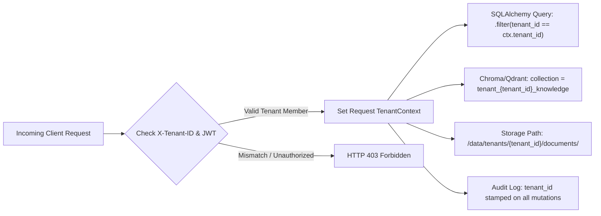
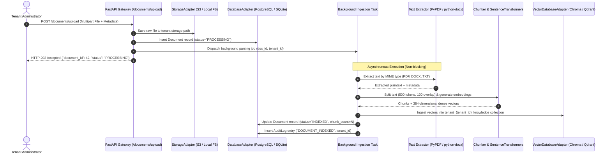
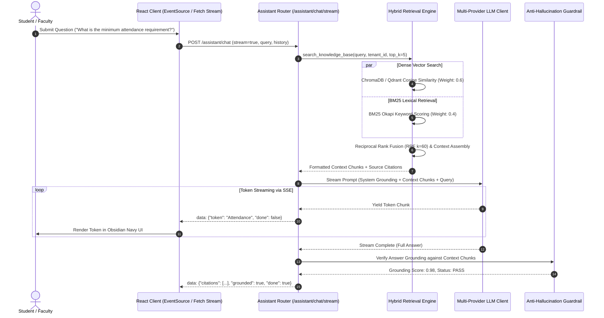

# Phase B Target Enterprise Architecture Specification
**Project:** UniMind AI + AegisOps Unified Enterprise Platform  
**Document:** Target Enterprise SaaS Architecture Blueprint  
**Version:** 2.0.0-Target  
**Date:** 2026-11-20  
**Author:** Senior Enterprise Software Architect & Technical Lead  
**Status:** `PROPOSED FOR STAKEHOLDER APPROVAL`  

---

## 1. Executive Summary

The target architecture defines the structural, operational, and security blueprint required to evolve the **UniMind AI + AegisOps** platform from an accepted multi-stage local monolith (Stages A–G) with hybrid distributed adapters (Stage H) into a commercially deployable, highly available, secure Multi-Tenant Enterprise SaaS Platform.

This architecture satisfies two non-negotiable operational requirements:
1. **Local-First Developer Ergonomics:** Zero external cloud dependencies for local development, runnable within an 8 GB RAM / 4 GB VRAM Windows 11 host with low disk footprint.
2. **Cloud-Native Enterprise Portability:** 100% cloud-ready modular architecture capable of zero-downtime deployment onto Kubernetes (EKS, GKE, AKS) with enterprise persistence (PostgreSQL, Qdrant cluster, Redis, AWS S3 / MinIO).

---

## 2. Layered Enterprise System Architecture

```mermaid
graph TD
    subgraph Client_Presentation_Tier ["Tier 1: Client Presentation Tier"]
        UI_SPA["React 18 + Vite SPA (Obsidian Navy UI)"]
        UI_ADMIN["Admin / Executive Dashboard"]
        UI_FACULTY["Faculty / Knowledge Portal"]
        UI_STUDENT["Student AI Assistant (SSE Stream)"]
        UI_SRE["AegisOps SRE Command Center"]
        UI_DIGITAL["Digital Twin Capacity Simulator"]
    end

    subgraph API_Gateway_Tier ["Tier 2: API Gateway & Security Tier"]
        GW["FastAPI REST & Streaming Gateway (Uvicorn / Gunicorn)"]
        MW_AUTH["JWT Authentication & Token Lifecycle"]
        MW_TENANT["Dynamic Tenant Resolver (X-Tenant-ID Header)"]
        MW_RBAC["Role-Based Access Control (RBAC Guard)"]
        MW_RATELIMIT["Sliding-Window Rate Limiting (Memory / Redis)"]
        MW_TRACE["Request Tracing & Correlation ID Injection"]
        GW_OPENAPI["OpenAPI 3.1 & Swagger / ReDoc Engine"]
    end

    subgraph Core_Services_Tier ["Tier 3: Core Domain Services Tier"]
        SVC_AUTH["Identity & Access Management (IAM)"]
        SVC_DOC["Document Processing & Text Extraction"]
        SVC_KNOWLEDGE["Knowledge Base & Hybrid Indexing Service"]
        SVC_ASSISTANT["Enterprise Assistant & Dialogue Orchestrator"]
        SVC_AGENT["Autonomous ReAct Multi-Step Agent Coordinator"]
        SVC_TICKETS["Helpdesk & Support Ticket Engine"]
        SVC_GOVERNANCE["Tenant Quotas, Token Limits & Audit Logger"]
    end

    subgraph AI_Intelligence_Tier ["Tier 4: AI & ML Intelligence Tier"]
        AI_RAG["Hybrid RAG Pipeline (Dense + BM25 Okapi + RRF k=60)"]
        AI_LLM["Multi-Provider LLM Router (OpenAI, Anthropic, Gemini, Groq, Ollama)"]
        AI_GUARD["Anti-Hallucination & Citation Verification Guardrail"]
        ML_ANOMALY["IsolationForest 5D Unsupervised Anomaly Engine"]
        AIOPS_RCA["AegisOps AI Root-Cause Diagnoser & SRE Runbooks"]
        AIOPS_REMED["Closed-Loop Self-Healing Remediation Engine (Safe/Destructive)"]
        DT_SIM["Digital Twin Academic Diurnal Simulator & Capacity Planner"]
    end

    subgraph Async_Worker_Tier ["Tier 5: Asynchronous Worker & Pipeline Tier"]
        BG_FASTAPI["FastAPI BackgroundTasks (Local-First Development)"]
        WORKER_QUEUE["Celery / RQ Distributed Task Queue (Enterprise SaaS)"]
        RING_BUFFER["Thread-Safe In-Memory / Redis Telemetry Ring Buffer"]
    end

    subgraph Adapters_Tier ["Tier 6: Infrastructure Abstraction Tier (Adapter Pattern)"]
        ADAPT_DB["DatabaseAdapter: SQLite WAL (Local) <--> PostgreSQL (Prod)"]
        ADAPT_VEC["VectorDatabaseAdapter: ChromaDB (Local) <--> Qdrant Cluster (Prod)"]
        ADAPT_CACHE["CacheAdapter: MemoryCache (Local) <--> Redis Cluster (Prod)"]
        ADAPT_STORE["StorageAdapter: Local Filesystem (Local) <--> S3/MinIO (Prod)"]
    end

    subgraph Infrastructure_Persistence_Tier ["Tier 7: Physical Infrastructure & Persistence Tier"]
        DB_SQLITE[("SQLite 3 (WAL Mode)")]
        DB_PG[("PostgreSQL 16 Cluster")]
        VEC_CHROMA[("ChromaDB Local HNSW")]
        VEC_QDRANT[("Qdrant Vector Engine")]
        CACHE_REDIS[("Redis 7.2 Sentinel")]
        OBJ_STORAGE[("Local Disk / AWS S3 Bucket")]
    end

    Client_Presentation_Tier --> API_Gateway_Tier
    API_Gateway_Tier --> Core_Services_Tier
    Core_Services_Tier --> AI_Intelligence_Tier
    Core_Services_Tier --> Async_Worker_Tier
    Core_Services_Tier --> Adapters_Tier
    AI_Intelligence_Tier --> Adapters_Tier
    Async_Worker_Tier --> Adapters_Tier
    Adapters_Tier --> Infrastructure_Persistence_Tier
```



---

## 3. Subsystem Specifications & Interaction Models

### 3.1 Multi-Tenant Isolation Architecture

The platform implements a strict **Tenant-Partitioned Architecture** ensuring complete logical isolation across relational data, vector indices, file storage, and API access boundaries:



1. **Relational Isolation:** Every database model (`User`, `Document`, `Ticket`, `Conversation`, `Incident`, `AuditLog`) enforces a foreign key constraint to `organizations.id`. All database queries are filtered by `tenant_id`.
2. **Vector Space Isolation:** Document vectors are ingested into tenant-dedicated collections (`tenant_{tenant_id}_knowledge`). Cross-tenant vector retrieval is strictly impossible at the collection query layer.
3. **Storage Isolation:** Physical files are stored under isolated filesystem or S3 object prefixes: `data/tenants/{tenant_id}/documents/{document_id}/`.
4. **Dynamic Context Switching:** Users belonging to multiple organizations can securely pass the `X-Tenant-ID` header. The target `tenant_deps.py` dynamically validates user membership within the requested tenant before authorizing operations.

---

### 3.2 Asynchronous Document Ingestion Pipeline

To resolve the synchronous event loop blocking during document parsing, the target architecture introduces an asynchronous ingestion pipeline:



---

### 3.3 Hybrid RAG & Streaming Dialogue Pipeline

The target architecture replaces buffered JSON responses with real-time **Server-Sent Events (SSE)** token streaming and anti-hallucination guardrail validation:



---

### 3.4 AegisOps Closed-Loop Anomaly Detection & Self-Healing

```mermaid
flowchart TD
    subgraph Telemetry_Collection ["Telemetry Ingestion"]
        SVC1["Auth Service"] --> RING["Telemetry Ring Buffer (Rolling 500 samples)"]
        SVC2["RAG Engine"] --> RING
        SVC3["Database Adapter"] --> RING
        SVC4["External Microservices"] --> RING
    end

    subgraph Anomaly_Detection ["ML Inference Pipeline"]
        RING --> FEAT["Feature Extractor (5D Vector: latency, error_rate, cpu, mem, qps)"]
        FEAT --> SCALER["StandardScaler Normalization"]
        SCALER --> IF["IsolationForest (Checksum: C2715221...)"]
        IF --> SCORE{"Anomaly Score > Threshold?"}
    end

    subgraph RCA_Diagnosis ["Root Cause Analysis"]
        SCORE -->|Yes| INCIDENT["Auto-Create Incident Record (OPEN, CRITICAL)"]
        SCORE -->|No| HEALTHY["Mark System HEALTHY"]
        INCIDENT --> RAG_RCA["AegisOps AI Runbook Diagnoser"]
        RAG_RCA --> REMED_PLAN["Generate Remediation Plan"]
    end

    subgraph Remediation_Execution ["Remediation Engine"]
        REMED_PLAN --> IS_SAFE{"Is Action Whitelisted as Non-Destructive?"}
        IS_SAFE -->|Yes (e.g. restart_service)| AUTO_EXEC["Execute Remediation Automatically"]
        IS_SAFE -->|No (e.g. rollback, scale_zero)| HITL["Queue for Human-in-the-Loop SRE Approval"]
        HITL -->|SRE Approves via UI| AUTO_EXEC
        HITL -->|SRE Rejects| CANCEL["Record Rejection in Audit Log"]
        AUTO_EXEC --> VERIFY{"Verify Metrics Normalization"}
        VERIFY -->|Healthy| RESOLVE["Update Incident to RESOLVED"]
        VERIFY -->|Unhealthy| ESCALATE["Escalate Alert to Platform Admin"]
    end
```

---

## 4. Hardware Sizing & Deployment Topologies

### 4.1 Local Development Topology (Current Hardware Constraint)
- **Target Machine:** Windows 11, Intel Core i5-12450H (8 cores/12 threads), 8 GB RAM, NVIDIA GTX 1650 (4 GB VRAM), 54 GB free disk.
- **Topology Configuration:**
  - Database: SQLite with Write-Ahead Logging (`WAL`) mode enabled. Max connection pool: 5.
  - Vector DB: ChromaDB in-process HNSW index (`data/chroma/`). Memory footprint: ~150 MB.
  - Cache: In-memory thread-safe dictionary cache (`MemoryCacheAdapter`). Memory footprint: < 20 MB.
  - Embeddings: `sentence-transformers/all-MiniLM-L6-v2` run on CPU or GTX 1650 via PyTorch FP16. Memory footprint: ~220 MB.
  - ML Anomaly Detector: `ml/models/isolation_forest.joblib` loaded into RAM (~5 MB).
  - Total Memory Footprint: ~1.8 GB RAM across FastAPI + Vite dev servers. Perfectly fits within the 7.71 GB usable ceiling.

### 4.2 Production Enterprise Cloud Topology (Kubernetes / Helm)
- **Target Environment:** AWS EKS / GCP GKE / Azure AKS.
- **Topology Configuration:**
  - Ingress: NGINX Ingress Controller with TLS termination and cert-manager Let's Encrypt.
  - API Gateway: 3–10 horizontal replicas of `unimind-ai-backend` autoscaled via Horizontal Pod Autoscaler (HPA) on CPU/Memory utilization.
  - Relational Database: Managed Amazon Aurora PostgreSQL (Multi-AZ with read replica).
  - Vector Database: Qdrant Distributed Cluster (3 nodes, distributed shard replication).
  - Cache & Celery Broker: Redis 7.2 Sentinel cluster with TLS and persistence.
  - Object Storage: AWS S3 with versioning, server-side encryption (SSE-KMS), and lifecycle retention rules.
  - Observability: Prometheus + Grafana stack scraping `/metrics` endpoint with OpenTelemetry tracing headers.

---

## 5. Summary of Architectural Evolutions (Stage H -> Phase B)

| Subsystem | Stage H (Current Accepted Baseline) | Phase B Target Enterprise Architecture |
| :--- | :--- | :--- |
| **Multi-Tenancy** | Single-tenant pinned in token | Dynamic multi-tenant switching via validated `X-Tenant-ID` header |
| **Document Ingestion** | Synchronous on request thread | Asynchronous background processing queue with progress tracking |
| **LLM Output Delivery** | Buffered JSON response | Real-time Server-Sent Events (SSE) streaming with live tokens |
| **Dependency Specs** | Incomplete `requirements.txt` | Clean, reproducible, pinned enterprise `requirements.txt` |
| **Database Concurrency** | SQLite single-process WAL | Pluggable PostgreSQL with connection pooling & Alembic migrations |
| **Telemetry & Services** | Simulated in-memory microservices | Dynamic service registry with live Prometheus metrics collection |
| **SRE Remediation** | Local simulated restart | Pluggable Kubernetes pod eviction / container restart runbooks |
| **Commercial SaaS** | Quota governance stubs | Stripe webhook billing integration with tier quota enforcement |

This target architecture ensures that every architectural modification remains strictly additive, backward-compatible, and reversible, fully adhering to local development constraints while unlocking commercial enterprise viability.
