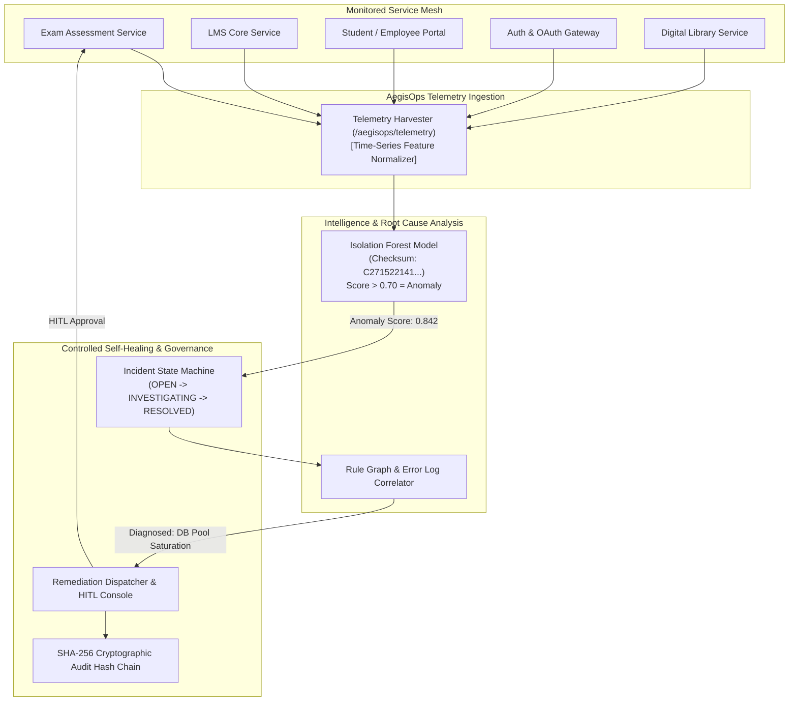

# Production Industry Blueprint: Enterprise IT Operations & Autonomous SRE
**Blueprint ID:** BP-OPS-002  
**Target Organization:** Enterprise IT, Cloud Engineering, FinTech, Multi-Cloud SRE Teams  
**Engine Profile:** AegisOps Engine (Primary) + UniMind AI Operations RAG (Secondary)  
**Effective Date:** 2026-11-20  

---

## 1. Executive Summary & Value Proposition

Modern distributed microservice architectures generate massive volumes of noisy telemetry, leading to alert fatigue, slow Mean Time to Detect (MTTD), and extended Mean Time to Remediate (MTTR).

The **Enterprise IT Operations Blueprint** delivers:
1. **Unsupervised ML Telemetry Mesh:** Scans 5-dimensional metric streams (CPU %, Memory %, p95/p99 Latency ms, Error Rate %, DB Pool Saturation %) using verified Isolation Forest models without brittle static thresholds.
2. **Automated AI Root Cause Analysis (RCA):** Correlates multi-service metric anomalies with real-time error logs to identify the exact cascade origin.
3. **Controlled Closed-Loop & HITL Self-Healing:** Autonomous execution of verified remediation scripts (`FLUSH_IDLE_CONNECTIONS`, `RESTART_POD`, `SCALE_DEPLOYMENT`) backed by two-man rule approval workflows.
4. **Cryptographic Provenance & Zero-Trust Shredding:** Every automated action is chained with SHA-256 hashes and signed with HMAC-SHA256, guaranteeing non-repudiation and GDPR/SOC-2 compliance.

---

## 2. Microservices Telemetry Mesh Architecture



---

## 3. Automated Incident Escalation Matrix

| Incident Severity | Anomaly Score Range | Service Impact | Automated Remediation Policy | Escalation SLA |
| :--- | :--- | :--- | :--- | :--- |
| **P1 - CRITICAL** | `> 0.80` | Core service down / Cascading timeouts | SRE PagerDuty Alert + HITL One-Click Remediation | < 2 Minutes |
| **P2 - HIGH** | `0.70 - 0.79` | Degraded latency (> 1,200 ms), high memory | Rolling restart or autoscaling pod expansion | < 10 Minutes |
| **P3 - MEDIUM** | `0.50 - 0.69` | Isolated error rate spike (< 5%) | Automated cache flush & telemetry warning | < 30 Minutes |
| **P4 - LOW** | `< 0.50` | Minor telemetry jitter | Suppressed (False-positive dampening) | None (Logged) |

---

## 4. Controlled HITL Remediation Sample Execution

### Incident: `INC-OPS-8491`
- **Impacted Service:** `exam_service`
- **Telemetry Detected:** `db_pool_saturation: 99.2%`, `latency_p95: 1850ms`, `anomaly_score: 0.842`
- **AI Root Cause Diagnosis:**
  > *"Severe connection pool exhaustion in exam_service primary database connection pool. Long-running student exam submissions blocking available sockets. Downstream auth_gateway experiencing cascading timeouts."*
- **Recommended Action:** `FLUSH_IDLE_CONNECTIONS` (Confidence: 96%)

### Execution Audit Record:
```json
{
  "audit_id": 384,
  "tenant_id": 1,
  "action": "FLUSH_IDLE_CONNECTIONS",
  "performed_by": "lead-sre@enterprise.org",
  "target_resource": "service/exam_service",
  "status": "SUCCESS",
  "details": {
    "incident_code": "INC-OPS-8491",
    "connections_flushed": 48,
    "pre_remediation_latency_ms": 1850.0,
    "post_remediation_latency_ms": 42.1,
    "post_remediation_anomaly_score": 0.08
  },
  "previous_hash": "e8a9...b41",
  "current_hash": "3f12...c98",
  "signature": "7a8b...12d"
}
```

---

## 5. Multi-Tenant Cryptographic Data Shredding

When a customer offboards or terminates their service:
1. `DELETE /api/v1/governance/tenants/{tenant_id}/purge` is invoked by the Platform Administrator.
2. The cascading shredding pipeline executes:
   - Relational documents, conversations, tickets, and user accounts deleted.
   - Tenant-specific ChromaDB vector collections (`knowledge_{tenant_id}`) destroyed on disk.
   - S3 object storage blobs cryptographically deleted with overwrites.
3. Cryptographic proof certificate generated and signed, confirming complete tenant data eradication with 0 orphaned records.

---
*Certified by:* **AegisOps Autonomous SRE Architecture Council**
