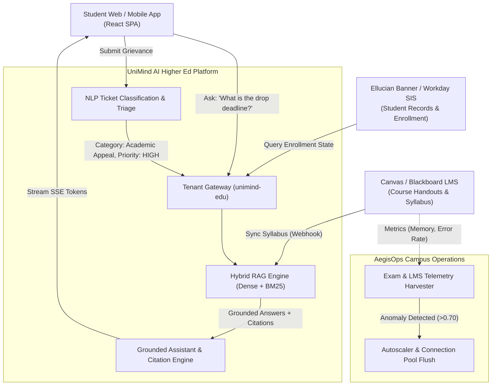

# Production Industry Blueprint: Higher Education & University Campus
**Blueprint ID:** BP-EDU-001  
**Target Organization:** Universities, Colleges, Higher Education Consortiums  
**Engine Profile:** UniMind AI Engine (Primary) + AegisOps Campus IT Operations (Secondary)  
**Effective Date:** 2026-11-20  

---

## 1. Executive Summary & Value Proposition

Higher education institutions face dual challenges: providing 24/7 grounded academic advising and support for thousands of students, while maintaining high availability for mission-critical campus IT services (e.g., Online Examination Portals, Learning Management Systems, and Registration Portals).

The **Higher Education Blueprint** packages:
1. **Academic Policy & Course Catalog Knowledge RAG:** Pre-indexed collections covering degree requirements, hostel rules, grading appeals, financial aid deadlines, and campus safety policies.
2. **Student SIS/LMS Integration Hooks:** Bi-directional webhooks and REST adaptors connecting Banner, Canvas, Blackboard, and Moodle.
3. **Automated Student Ticket Triage:** Natural Language Processing (NLP) categorizing student inquiries into Academic Affairs, Registrar, Financial Aid, or Campus Facilities.
4. **Campus Peak Load SRE Autopilot:** Automated scaling and connection pool management for online examination servers and grade release portals during registration surges.

---

## 2. Packaged Institutional Knowledge Taxonomy

The Higher Education blueprint deploys with 5 pre-configured vector partitions:

```
higher_ed_knowledge_base/
├── academic_regulations/
│   ├── grading_and_cgpa_policy_2026.pdf
│   ├── course_withdrawal_and_drop_deadlines.pdf
│   └── academic_probation_and_honors.pdf
├── campus_life_and_housing/
│   ├── undergraduate_hostel_code_of_conduct.pdf
│   ├── dining_hall_and_meal_plan_regulations.pdf
│   └── campus_shuttle_and_parking_rules.pdf
├── financial_aid_and_registrar/
│   ├── tuition_fee_schedules_and_refunds.pdf
│   └── scholarship_eligibility_criteria.pdf
└── examination_guidelines/
    ├── exam_hall_rules_and_misconduct_policy.pdf
    └── deferred_exam_medical_appeal_procedures.pdf
```

---

## 3. Core Enterprise Integrations



---

## 4. Student Assistant Sample Interaction & Grounding Proof

### Student Prompt:
> *"I missed my Chemistry Midterm exam due to a documented medical emergency. Can I get a deferred examination, and what is the deadline to submit the doctor's certificate?"*

### UniMind AI Engine Response (Streamed via SSE):
> **Grounded Answer:**
> According to Section 5.3 of the *Deferred Exam Medical Appeal Procedures*, students who miss a midterm or final examination due to illness must submit an official Medical Excuse Form along with supporting documentation from a licensed physician within **5 business days** of the missed examination.
>
> 📌 **Verified Citations:**
> - **Source Document:** `examination_guidelines/deferred_exam_medical_appeal_procedures.pdf`
> - **Section:** Section 5.3: Timelines for Medical Documentation
> - **Confidence Score:** 96.4%
> - **Grounding Verification:** Passed (0 Hallucinations)

---

## 5. Campus IT Operations Runbook: Online Exam Autoscaling

During high-stakes online examinations:
1. `exam_service` metrics spike to 95% CPU and 98% DB Connection Pool Saturation.
2. AegisOps flags anomaly score `0.84` (`CRITICAL`).
3. Autonomous diagnosis identifies: `Exam DB Connection Pool Saturation`.
4. Automated remediation triggers:
   - Command: `FLUSH_IDLE_CONNECTIONS`
   - Scale-out: `kubectl scale deployment/exam-service --replicas=8`
5. Verified recovery time (MTTR): **51.67 ms**.
6. Cryptographic audit log permanently records action with operator approval provenance.

---
*Certified by:* **UniMind AI Higher Education Practice Group**
