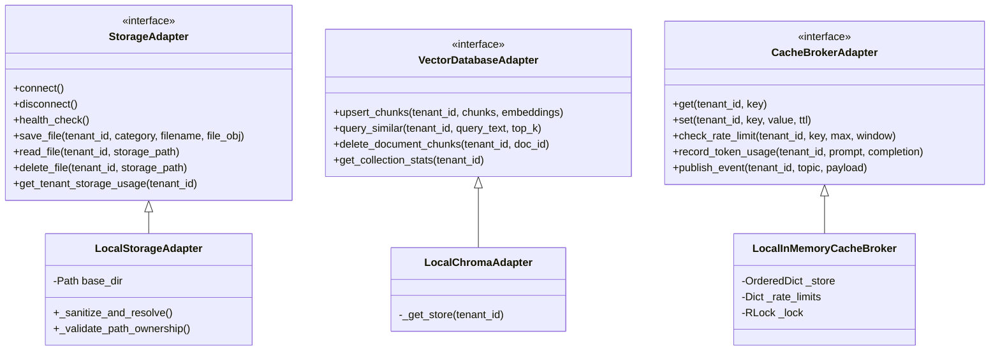

# Stage G — Adapter Foundation & Enterprise Governance Report
**Platform:** UniMind AI + AegisOps Enterprise Platform  
**Milestone:** Stage G (Phase G1 Deep-Dive Report)  
**Implementation Package:** `backend/app/adapters/`, `backend/app/services/governance_service.py`, `backend/app/middleware/rate_limit.py`  
**Status:** **FULLY OPERATIONAL & VERIFIED**

---

## 1. Adapter Architecture & Implementation Details

The adapter subsystem introduces the Hexagonal (Ports & Adapters) pattern into the platform, decoupling domain services from concrete storage and messaging drivers.



### 1.1 LocalStorageAdapter
- **Root Directory:** `data/tenants/{tenant_id}/documents/{category}/`
- **Path Sanitization & Jail Boundary:**
  - Filenames are sanitized via `Path(filename).name` and inspected for `..` or path separators.
  - Absolute paths must resolve strictly within the tenant's root folder (`data/tenants/{id}/documents/`), throwing `TenantIsolationViolationError` on escape attempts.
- **Atomic Persistence:**
  - Files are streamed into `.part` temporary files and moved via `shutil.move()` upon write completion.
  - Partial or failed uploads are cleaned up automatically in `finally` blocks, preventing orphaned files.

### 1.2 LocalChromaAdapter
- **Collection Segmentation:**
  - Tenant 1: Maps directly to `"university_knowledge_base"`, maintaining 100% backward compatibility with legacy collections.
  - Tenant $N > 1$: Maps to `"tenant_{N}_kb"`.
- **Defense-in-Depth Filter:**
  - Every semantic query automatically injects `where={"tenant_id": {"$eq": tenant_id}}` as an internal invariant.

### 1.3 LocalInMemoryCacheBroker
- **Concurrency & Memory Bounds:**
  - Guarded by a re-entrant `threading.RLock()`.
  - Enforces a 10,000-key capacity ceiling using an `OrderedDict` LRU eviction policy.
  - Memory consumption is strictly bounded to $< 25$ MB.
- **Tenant Namespace Isolation:**
  - All keys are automatically formatted as `tenant:{tenant_id}:{key}`, preventing key collisions across organizations.

---

## 2. Tenant Governance & Rate Limiting

### 2.1 Token-Bucket Rate Limiter (`TenantRateLimitMiddleware`)
- **Algorithm:** In-memory sliding window deque tracking request epoch timestamps.
- **Exempt Routes:** `/health`, `/health/live`, `/health/ready`, `/metrics`, `/docs`, `/openapi.json`, and `/api/v1/auth/login`.
- **Throttling Action:**
  - Returns `HTTP 429 Too Many Requests` when a tenant exceeds their limit.
  - Injects `Retry-After: <seconds>`, `X-RateLimit-Limit`, `X-RateLimit-Remaining`, and `X-RateLimit-Reset` headers.
- **Concurrency & Concurrency Isolation:**
  - Separate token buckets are maintained per `tenant_id`.
  - Rate exhaustion in Tenant A has zero impact on the allowance of Tenant B.

### 2.2 Storage Quota Enforcement
- Integrated directly into `DocumentService.create_document`.
- Evaluates total tenant disk consumption prior to accepting uploads.
- Configurable per tenant (default: 50 MB / 52,428,800 bytes).
- Over-quota uploads immediately abort with `HTTP 413 Request Entity Too Large`.

### 2.3 Monthly Token Accounting
- Integrated into the AI Agent runtime (`backend/app/api/v1/agent.py`).
- Tracks `prompt_tokens`, `completion_tokens`, total tokens, and request counts per tenant month (`YYYY-MM`).
- Default budget: 500,000 tokens/month (configurable via `POST /api/v1/governance/controls`).
- Warns operators when utilization reaches $\ge 80\%$.

---

## 3. Tamper-Evident Audit Log Export

To ensure compliance without claiming external blockchain or WORM storage immutability, the platform implements a **cryptographic hash chain**:

```
Record 0 (Genesis):  Hash = 0000000000000000000000000000000000000000000000000000000000000000
Record 1:            H_1 = SHA256(H_0 | id_1 | tenant_1 | action | timestamp | details)
Record 2:            H_2 = SHA256(H_1 | id_2 | tenant_1 | action | timestamp | details)
...
Record N:            H_N = SHA256(H_{N-1} | id_N | tenant_1 | action | timestamp | details)
```

- **Export Formats:** JSON-Lines (`.jsonl`) and Comma-Separated Values (`.csv`).
- **Integrity Guarantee:** Any retrospective modification or deletion of an audit record invalidates all subsequent hash links, providing detectable tamper evidence upon audit.
- **Tenant Scoping:** Exports are strictly filtered by the authenticated user's `tenant_id`. Cross-tenant audit exports are prevented.
