# Stage G — Complete Implementation & Verification Report
**Platform:** UniMind AI + AegisOps Enterprise Platform  
**Milestone:** Stage G — Enterprise Governance, Closed-Loop Operations & Pluggable Infrastructure Adapters  
**Execution Mode:** Consolidated Execution (Phases G1 through G5)  
**Execution Date:** November 18, 2026  
**Environment:** Windows 11 Home, Intel Core i5-12450H (12 vCPUs), 7.71 GB RAM, Python 3.11.9, Node.js v20.18.0  
**Overall Status:** **100% IMPLEMENTED, INTEGRATED & VERIFIED**

---

## 1. Executive Summary

This document certifies the successful completion of the **Stage G** milestone for the UniMind AI + AegisOps enterprise platform.

Transforming the verified Stage F modular monolith into an enterprise-governed, observable, and operationally integrated system, Stage G establishes clean adapter contracts, tenant quotas, closed-loop Digital Twin incident remediation, and Prometheus observability without introducing heavyweight external dependencies or exceeding workstation memory budgets.

```mermaid
flowchart TD
    subgraph G1 ["Stage G1: Adapters & Governance"]
        A1["StorageAdapter & LocalStorageAdapter"]
        A2["VectorDatabaseAdapter & LocalChromaAdapter"]
        A3["CacheBrokerAdapter & LocalInMemoryCacheBroker"]
        A4["Token-Bucket Rate Limiter (HTTP 429)"]
        A5["Storage Quota Enforcer (HTTP 413)"]
        A6["Tamper-Evident Audit Hash-Chaining"]
    end

    subgraph G2 ["Stage G2: Closed-Loop Operations"]
        B1["Predictive Event Ingestion (Thermal, Traffic, Exhaustion)"]
        B2["Mandatory PENDING_APPROVAL Default"]
        B3["Human-in-the-Loop Approval & Reject Workflows"]
        B4["Event-to-Incident Traceability & Audit Logs"]
    end

    subgraph G3 ["Stage G3: Observability & Health"]
        C1["Prometheus Metrics (/metrics - Format 0.0.4)"]
        C2["Liveness & Readiness Probes (/health/live, /health/ready)"]
        C3["Structured Request Logging & X-Request-ID Tracking"]
    end

    subgraph G4 ["Stage G4: Enterprise Frontend"]
        D1["Tenant Governance Dashboard (TenantGovernanceView.jsx)"]
        D2["Observability Dashboard (ObservabilityView.jsx)"]
        D3["Zero-Error Vite Production Build (1,492 Modules)"]
    end

    subgraph G5 ["Stage G5: Full Integration & Freeze"]
        E1["74/74 Passing Automated Tests (100%)"]
        E2["14/14 Cross-Tenant Security Checks Passed"]
        E3["Peak Process Memory: 550.52 MB (Budget: 750 MB)"]
        E4["Forensic Model & DB Preservation (SHA-256 Verified)"]
    end

    G1 --> G2 --> G3 --> G4 --> G5
```

---

## 2. Phase-by-Phase Execution Summary

### Phase G1: Adapter Foundation, Tenant Governance & Quota Enforcement
- **Abstract Ports & Local Adapters:** Authored `backend/app/adapters/` containing abstract base classes (`StorageAdapter`, `VectorDatabaseAdapter`, `CacheBrokerAdapter`) and concrete local implementations (`LocalStorageAdapter`, `LocalChromaAdapter`, `LocalInMemoryCacheBroker`) wrapped by `AdapterFactory`.
- **Tenant-Scoped Rate Limiting:** Enforced via `TenantRateLimitMiddleware` using an in-memory sliding token bucket returning `HTTP 429 Too Many Requests` with `Retry-After` headers upon threshold breach.
- **Storage Quota Enforcement:** Integrated into `DocumentService.create_document`, rejecting uploads exceeding tenant quotas with `HTTP 413 Request Entity Too Large`.
- **Token Accounting:** Implemented monthly LLM token tracking (`prompt_tokens`, `completion_tokens`, total) with an 80% soft warning threshold and reporting endpoints.
- **Tamper-Evident Audit Export:** Implemented cryptographically hash-chained export (`/api/v1/governance/audit/export`) supporting JSONL and CSV formats.

### Phase G2: Closed-Loop Digital Twin & AegisOps Operations
- **Predictive Event Ingestion:** Connected Digital Twin simulations to AegisOps via `POST /api/v1/digital-twin/events/predictive-alert`, supporting `THERMAL_SPIKE`, `TRAFFIC_SURGE`, `RESOURCE_EXHAUSTION`, and `OPERATIONAL_ANOMALY`.
- **Mandatory Approval Default:** All proactive incident playbooks default strictly to `PENDING_APPROVAL`. No automated infrastructure mutations execute autonomously.
- **Human-in-the-Loop Approval Workflows:** Authored authenticated operator endpoints:
  - `POST /api/v1/digital-twin/proactive-remediation/approve`
  - `POST /api/v1/digital-twin/proactive-remediation/reject`
  - `POST /api/v1/digital-twin/proactive-remediation/cancel`
- **Traceability:** Every transition records tenant-attributed records in `audit_logs`.

### Phase G3: Production Observability & Health Probing
- **Prometheus Metrics (`/metrics`):** Implemented pure Python Prometheus exposition format 0.0.4 exposing request counters, latency histograms, error rates, anomaly scores, and adapter metrics with bounded label cardinality.
- **Kubernetes Probes:** Added `/health/live` (process health) and `/health/ready` (dependency checks for database, vector store, and adapters).
- **Structured Tracing:** All HTTP requests inject `X-Request-ID` and `X-Process-Time` response headers.

### Phase G4: Enterprise Governance Frontend Dashboard
- **`TenantGovernanceView.jsx`:** Provides real-time gauges for document storage utilization, monthly token consumption, sliding-window rate limit status, admin quota update forms, and audit export downloads.
- **`ObservabilityView.jsx`:** Visualizes live readiness probe states, processed requests, HTTP errors, anomaly scores, and a live raw `/metrics` scrape feed.
- **Production Build:** `npm run build` executed cleanly in 36.57s with 0 errors across 1,492 transformed modules.

### Phase G5: Full Integration, Verification & Baseline Freeze
- **Regression Testing:** **74 / 74 tests passed** (100% pass rate in 91.82s).
- **Cross-Tenant Security Audit:** **14 / 14 assertion blocks passed** in 56.88s with zero data leakage.
- **Hardware Profile:** Measured peak working set memory of **550.52 MB** (well under the 750 MB limit, consuming only 6.97% of host RAM).
- **Asset Integrity:** Forensic verification confirmed that `ml/models/isolation_forest.joblib` (SHA-256: `c271522...`) and `unimind.db` (`PRAGMA integrity_check: ok`) remain 100% intact.

---

## 3. Verification Scorecard

| Milestone Component | Target Metric | Achieved Result | Status |
| :--- | :--- | :--- | :---: |
| **Automated Tests** | $\ge 70$ tests passing | **74 passed, 0 failed, 0 skipped** | **PASS** |
| **Security Probes** | 14 cross-tenant checks | **14 / 14 passed (0 leaks)** | **PASS** |
| **Process RAM (Peak)**| $\le 750$ MB | **550.52 MB (6.97% host RAM)** | **PASS** |
| **RAG Latency (Warm)**| $< 200$ ms | **36.98 ms** | **PASS** |
| **Anomaly Scoring Latency**| $< 50$ ms | **29.55 ms** | **PASS** |
| **Frontend Production Build**| 0 errors | **0 errors (1,492 modules)** | **PASS** |
| **Model Checksum** | SHA-256 match | **`c271522...` (100% match)** | **PASS** |
| **SQLite DB Integrity** | PRAGMA check | **`ok` (0 violations)** | **PASS** |
| **ChromaDB Collections** | $\ge 8$ legitimate chunks | **8 chunks intact** | **PASS** |

---

## 4. Deployment Readiness Tiers

1. **Local Development Environment:** **100% CERTIFIED & VERIFIED**
   - Self-contained, zero external daemons, operates inside 8 GB RAM budget.
2. **Single-Host Staging & Pilot Deployment:** **100% CERTIFIED & VERIFIED**
   - Multi-tenant governance, rate limiting, and observability fully operational.
3. **Multi-Node Distributed Enterprise Cluster:** **PREREQUISITES REMAIN (STAGE H+)**
   - Unapproved for current release. Distributed PostgreSQL HA, remote Qdrant, Redis task brokers, and S3 storage remain future prerequisites.
