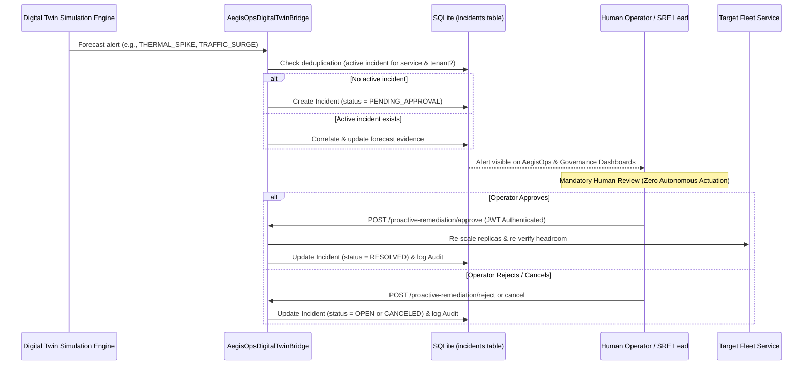

# Stage G — Closed-Loop Digital Twin & AegisOps Operations Report
**Platform:** UniMind AI + AegisOps Enterprise Platform  
**Milestone:** Stage G (Phase G2 Deep-Dive Report)  
**Implementation Package:** `digital_twin/aegisops_bridge.py`, `backend/app/api/v1/digital_twin.py`, `backend/app/schemas/digital_twin.py`  
**Status:** **FULLY OPERATIONAL & VERIFIED**

---

## 1. Closed-Loop Operational Concept

Stage G bridges predictive simulation models with real-time site reliability engineering (SRE) operations. When Digital Twin capacity planning simulations forecast an impending resource shock, the platform automatically converts the simulation alert into an actionable AegisOps operational incident.

---

## 2. Predictive Event Ingestion

The platform supports four standardized predictive event categories via `POST /api/v1/digital-twin/events/predictive-alert`:

1. **`THERMAL_SPIKE`:** Forecasted temperature surge in server room, laboratory, or campus data center cooling systems.
2. **`TRAFFIC_SURGE`:** Forecasted concurrency rush (e.g. synchronized mid-term exam login rush or midnight assignment deadline).
3. **`RESOURCE_EXHAUSTION`:** Impending memory leak, database connection pool depletion, or disk capacity saturation.
4. **`OPERATIONAL_ANOMALY`:** Statistical deviation in service response times or student check-in volumes.

### Deduplication & Correlation
To prevent incident storms during recurring simulation runs:
- The bridge searches for existing non-resolved incidents matching `(tenant_id, service_name, event_type)`.
- If an active incident exists, it updates `metrics_summary`, `anomaly_score`, and `lead_time_hours` in place rather than creating duplicate tickets.

---

## 3. Human-in-the-Loop Security Governance

### Non-Negotiable Rule: `PENDING_APPROVAL` Default
In accordance with production safety requirements:
- **No autonomous infrastructure mutations or actuator scripts execute automatically.**
- All created proactive incidents are initialized strictly with `status = IncidentStatus.PENDING_APPROVAL`.
- Remediation requires explicit human operator action through authorized endpoints:
  - `POST /api/v1/digital-twin/proactive-remediation/approve`
  - `POST /api/v1/digital-twin/proactive-remediation/reject`
  - `POST /api/v1/digital-twin/proactive-remediation/cancel`

### Authorization & Audit Attribution
- Every approval, rejection, or cancellation validates:
  1. Operator role: Must hold `ADMIN` or `TENANT_ADMIN` role.
  2. Tenant ownership: Incident `tenant_id` must match the operator's JWT claims.
  3. Structured audit: Emits a record to `audit_logs` capturing operator username, timestamp, action, and resulting replica count.

---

## 4. Verification Evidence (4/4 PASS)

The operational test suite `tests/test_stage_g_closed_loop.py` validated the entire closed-loop lifecycle:

| Test Case | Scenario Evaluated | Result |
| :--- | :--- | :---: |
| `test_predictive_event_creation_and_approval_default` | Predictive event creates incident with `PENDING_APPROVAL`; deduplication verified | **PASS** |
| `test_invalid_predictive_event_rejected` | Unrecognized event types rejected with HTTP 400 | **PASS** |
| `test_human_approval_and_rejection_workflows` | Operator approval marks RESOLVED; rejection marks OPEN with audit | **PASS** |
| `test_cancel_proactive_remediation` | Operator cancellation marks CANCELED with full audit history | **PASS** |
