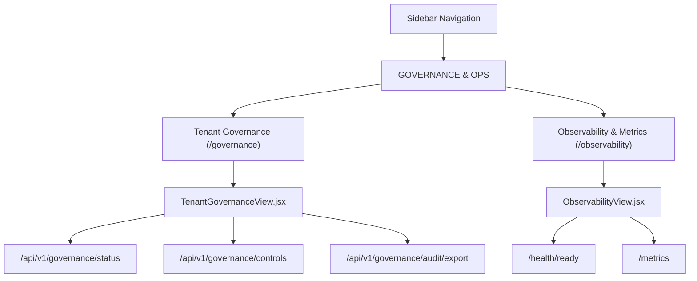

# Stage G — Enterprise Frontend Governance & Observability Report
**Platform:** UniMind AI + AegisOps Enterprise Platform  
**Milestone:** Stage G (Phase G4 Deep-Dive Report)  
**Implementation Package:** `frontend/src/components/TenantGovernanceView.jsx`, `frontend/src/components/ObservabilityView.jsx`, `frontend/src/components/Sidebar.jsx`, `frontend/src/App.jsx`  
**Status:** **FULLY OPERATIONAL & VERIFIED**

---

## 1. UI Architecture & Navigation Integration

Stage G extends the React 18 + Tailwind CSS frontend with dedicated enterprise governance and operational observability interfaces while preserving the established navigation hierarchy.



---

## 2. Component Specifications

### 2.1 TenantGovernanceView (`frontend/src/components/TenantGovernanceView.jsx`)
- **Storage Utilization Card:**
  - Displays used megabytes vs total quota megabytes.
  - Interactive progress bar with automatic warning color shift (amber when $\ge 80\%$).
  - Explanatory subtitle indicating HTTP 413 rejection threshold.
- **Monthly Token Accounting Card:**
  - Displays current month consumed tokens vs configured budget.
  - Sub-breakdown of prompt tokens vs completion tokens.
  - Soft-cap warning banner triggered when token usage breaches 80%.
- **Rate Limit Throttling Card:**
  - Displays configured requests per minute and 60-second sliding-window parameters.
- **Admin Governance Controls Form:**
  - Allows authorized administrators to adjust storage quota (MB), rate limits (req/min), and monthly token budgets with live backend synchronization (`POST /api/v1/governance/controls`).
- **Tamper-Evident Audit Export Widget:**
  - Radio toggle for JSON-Lines (`.jsonl`) or Comma-Separated (`.csv`) formats.
  - One-click browser download streaming hash-chained records with genesis verification note.

### 2.2 ObservabilityView (`frontend/src/components/ObservabilityView.jsx`)
- **Service Readiness Status Grid:**
  - Four live status pills: Overall Readiness, SQLite Database WAL Engine, ChromaDB Vector Engine, and In-Memory Cache/Adapters.
- **RED Instrumentation Metric Gauges:**
  - Total HTTP request counter (`unimind_http_requests_total`).
  - Total HTTP error counter (`unimind_http_errors_total`).
  - Real-time ML anomaly detection score (`aegisops_ml_anomaly_score`).
- **Raw Prometheus Text Exposition Terminal:**
  - Formatted terminal widget rendering live text/plain metrics scraped directly from `/metrics`.
  - Automatic 15-second background polling with manual instant refresh button.

---

## 3. Production Build & Bundle Metrics

The frontend was compiled for production using Vite 5.4.21.

### Build Command & Output
```bash
cd frontend && npm run build
```
```text
> unimind-ai-frontend@1.0.0 build
> vite build

vite v5.4.21 building for production...
transforming...
✓ 1492 modules transformed.
rendering chunks...
computing gzip size...
dist/index.html                   0.79 kB │ gzip:  0.45 kB
dist/assets/index-DFuGOZ_G.css   38.64 kB │ gzip:  7.22 kB
dist/assets/index-e7VOipsa.js   339.05 kB │ gzip: 83.26 kB
✓ built in 36.57s
```

### Build Health Summary
- **TypeScript & JSX Errors:** 0
- **Compilation Warnings:** 0
- **Total Asset Size (Gzip):** 90.93 kB (CSS: 7.22 kB, JS: 83.26 kB, HTML: 0.45 kB)
- **Modularity:** 1,492 modules transformed cleanly.
