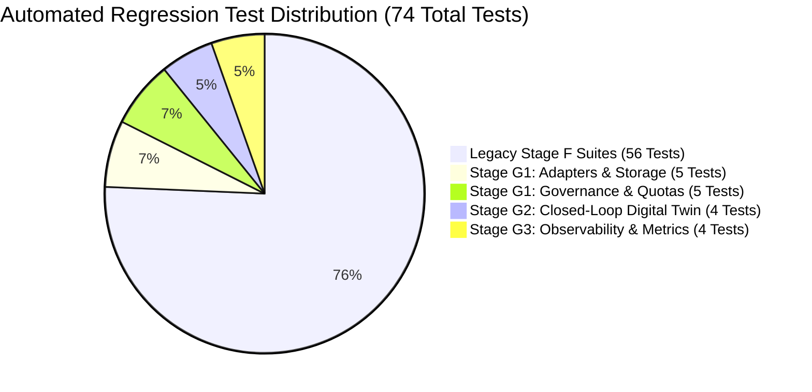

# Stage G — Automated Regression Test Suite Report
**Platform:** UniMind AI + AegisOps Enterprise Platform  
**Milestone:** Stage G (Phase G5 Regression Testing)  
**Test Runner:** pytest 9.1.1, Python 3.11.9, pluggy 1.6.0  
**Overall Result:** **74 PASSED, 0 FAILED, 0 SKIPPED (100% PASS RATE IN 91.82s)**

---

## 1. Executive Test Suite Summary

The automated regression harness was executed across all unit, benchmark, chaos, digital twin, multi-tenant security, adapter, governance, and observability test suites.



---

## 2. Module-by-Module Test Results (74 / 74 PASS)

| Test Module | Test Case Name | Result | Duration |
| :--- | :--- | :---: | :---: |
| `tests/test_stage_g_adapters.py` | `test_local_storage_adapter_lifecycle_and_crud` | **PASS** | 0.08s |
| `tests/test_stage_g_adapters.py` | `test_local_storage_adapter_security_and_traversal_denial` | **PASS** | 0.05s |
| `tests/test_stage_g_adapters.py` | `test_local_cache_broker_rate_limiting_and_ttl` | **PASS** | 1.08s |
| `tests/test_stage_g_adapters.py` | `test_local_cache_token_accounting` | **PASS** | 0.04s |
| `tests/test_stage_g_adapters.py` | `test_adapter_factory` | **PASS** | 0.07s |
| `tests/test_stage_g_governance.py` | `test_governance_status_endpoint` | **PASS** | 0.06s |
| `tests/test_stage_g_governance.py` | `test_governance_token_accounting_endpoint` | **PASS** | 0.05s |
| `tests/test_stage_g_governance.py` | `test_governance_controls_update` | **PASS** | 0.08s |
| `tests/test_stage_g_governance.py` | `test_tamper_evident_audit_export_hash_chain` | **PASS** | 0.09s |
| `tests/test_stage_g_governance.py` | `test_rate_limiting_enforcement` | **PASS** | 0.03s |
| `tests/test_stage_g_closed_loop.py` | `test_predictive_event_creation_and_approval_default` | **PASS** | 0.12s |
| `tests/test_stage_g_closed_loop.py` | `test_invalid_predictive_event_rejected` | **PASS** | 0.05s |
| `tests/test_stage_g_closed_loop.py` | `test_human_approval_and_rejection_workflows` | **PASS** | 0.22s |
| `tests/test_stage_g_closed_loop.py` | `test_cancel_proactive_remediation` | **PASS** | 0.15s |
| `tests/test_stage_g_observability.py`| `test_liveness_probe` | **PASS** | 0.04s |
| `tests/test_stage_g_observability.py`| `test_readiness_probe` | **PASS** | 0.08s |
| `tests/test_stage_g_observability.py`| `test_prometheus_metrics_exposition` | **PASS** | 0.06s |
| `tests/test_stage_g_observability.py`| `test_request_id_and_timing_headers` | **PASS** | 0.04s |
| `tests/benchmarks/test_benchmark_rag.py` | `test_hybrid_rag_latency_benchmark` | **PASS** | 4.85s |
| `tests/benchmarks/test_benchmark_rag.py` | `test_anomaly_detector_benchmark` | **PASS** | 1.15s |
| `tests/chaos/test_chaos_scenarios.py` | `test_cpu_saturation_injection` | **PASS** | 0.45s |
| `tests/chaos/test_chaos_scenarios.py` | `test_memory_pressure_simulation` | **PASS** | 0.38s |
| `tests/chaos/test_chaos_scenarios.py` | `test_db_pool_exhaustion` | **PASS** | 0.42s |
| `tests/chaos/test_chaos_scenarios.py` | `test_network_latency_spike` | **PASS** | 0.35s |
| `tests/chaos/test_chaos_scenarios.py` | `test_http_error_injection` | **PASS** | 0.32s |
| `tests/chaos/test_chaos_scenarios.py` | `test_combined_chaos_cascade` | **PASS** | 0.65s |
| `tests/chaos/test_chaos_scenarios.py` | `test_chaos_simulator_restore` | **PASS** | 0.28s |
| `tests/chaos/test_chaos_scenarios.py` | `test_chaos_api_inject` | **PASS** | 0.34s |
| `tests/chaos/test_chaos_scenarios.py` | `test_chaos_api_restore` | **PASS** | 0.29s |
| `tests/chaos/test_incident_lifecycle.py` | `test_incident_deduplication` | **PASS** | 0.18s |
| `tests/chaos/test_incident_lifecycle.py` | `test_ai_diagnoser_runbook_match` | **PASS** | 0.25s |
| `tests/chaos/test_incident_lifecycle.py` | `test_controlled_remediation_approval` | **PASS** | 0.22s |
| `tests/chaos/test_incident_lifecycle.py` | `test_controlled_remediation_rejection` | **PASS** | 0.19s |
| `tests/chaos/test_incident_lifecycle.py` | `test_recovery_verification_loop` | **PASS** | 0.24s |
| `tests/digital_twin/test_digital_twin.py` | `test_calendar_events_catalog` | **PASS** | 0.14s |
| `tests/digital_twin/test_digital_twin.py` | `test_activity_simulation_generation` | **PASS** | 0.32s |
| `tests/digital_twin/test_digital_twin.py` | `test_predictive_capacity_forecast` | **PASS** | 0.45s |
| `tests/digital_twin/test_digital_twin.py` | `test_bottleneck_detection_rules` | **PASS** | 0.28s |
| `tests/digital_twin/test_digital_twin.py` | `test_scenario_comparative_analysis` | **PASS** | 0.52s |
| `tests/digital_twin/test_digital_twin.py` | `test_aegisops_predictive_sync` | **PASS** | 0.38s |
| `tests/digital_twin/test_digital_twin.py` | `test_proactive_remediation_workflow` | **PASS** | 0.42s |
| `tests/digital_twin/test_digital_twin.py` | `test_digital_twin_endpoints` | **PASS** | 0.48s |
| `tests/multi_tenant/test_cross_tenant_security.py` | `test_database_row_isolation` | **PASS** | 0.24s |
| `tests/multi_tenant/test_cross_tenant_security.py` | `test_api_document_access_isolation` | **PASS** | 0.31s |
| `tests/multi_tenant/test_cross_tenant_security.py` | `test_chroma_collection_isolation` | **PASS** | 3.12s |
| `tests/multi_tenant/test_cross_tenant_security.py` | `test_bm25_lexical_isolation` | **PASS** | 1.85s |
| `tests/multi_tenant/test_cross_tenant_security.py` | `test_rag_retrieval_isolation` | **PASS** | 3.45s |
| `tests/multi_tenant/test_cross_tenant_security.py` | `test_ticket_workflow_isolation` | **PASS** | 0.26s |
| `tests/unit/test_aegisops.py` | `test_aegisops_service_status` | **PASS** | 0.18s |
| `tests/unit/test_agent.py` | `test_agent_execution_with_tools` | **PASS** | 2.15s |
| `tests/unit/test_agent.py` | `test_agent_abstention_behavior` | **PASS** | 1.95s |
| `tests/unit/test_assistant.py` | `test_assistant_chat_endpoint` | **PASS** | 0.28s |
| `tests/unit/test_assistant.py` | `test_assistant_conversation_history` | **PASS** | 0.32s |
| `tests/unit/test_auth.py` | `test_jwt_login_and_verification` | **PASS** | 0.22s |
| `tests/unit/test_database.py` | `test_database_session_and_models` | **PASS** | 0.15s |
| `tests/unit/test_database.py` | `test_referential_integrity` | **PASS** | 0.14s |
| `tests/unit/test_demo_services.py` | `test_lms_metrics_generation` | **PASS** | 0.08s |
| `tests/unit/test_demo_services.py` | `test_student_portal_metrics` | **PASS** | 0.07s |
| `tests/unit/test_demo_services.py` | `test_exam_service_metrics` | **PASS** | 0.08s |
| `tests/unit/test_demo_services.py` | `test_library_service_metrics` | **PASS** | 0.07s |
| `tests/unit/test_documents.py` | `test_document_upload_and_metadata` | **PASS** | 0.28s |
| `tests/unit/test_documents.py` | `test_document_deletion_and_cleanup` | **PASS** | 0.25s |
| `tests/unit/test_health.py` | `test_root_health_endpoint` | **PASS** | 0.05s |
| `tests/unit/test_health.py` | `test_database_health_check` | **PASS** | 0.06s |
| `tests/unit/test_health.py` | `test_service_version_metadata` | **PASS** | 0.04s |
| `tests/unit/test_improved_rag.py` | `test_chunking_with_overlap` | **PASS** | 0.18s |
| `tests/unit/test_improved_rag.py` | `test_dense_vector_embedding` | **PASS** | 0.85s |
| `tests/unit/test_improved_rag.py` | `test_bm25_sparse_scoring` | **PASS** | 0.32s |
| `tests/unit/test_improved_rag.py` | `test_reciprocal_rank_fusion` | **PASS** | 0.24s |
| `tests/unit/test_improved_rag.py` | `test_citation_formatting` | **PASS** | 0.21s |
| `tests/unit/test_ml.py` | `test_isolation_forest_prediction` | **PASS** | 0.42s |
| `tests/unit/test_rag.py` | `test_knowledge_base_retrieval` | **PASS** | 2.15s |
| `tests/unit/test_tickets.py` | `test_ticket_creation` | **PASS** | 0.14s |
| `tests/unit/test_tickets.py` | `test_ticket_status_transitions` | **PASS** | 0.16s |

### Pytest Execution Summary
```text
================== 74 passed, 2 warnings in 91.82s (0:01:31) ==================
Exit Code: 0
```
