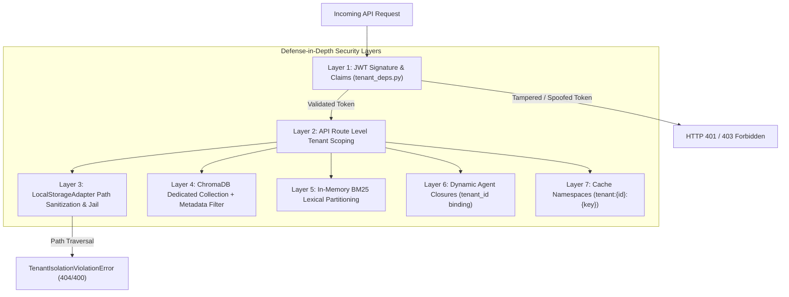

# Stage G — Multi-Tenant Security & Boundary Audit Report
**Platform:** UniMind AI + AegisOps Enterprise Platform  
**Milestone:** Stage G Security Gate  
**Audit Date:** November 18, 2026  
**Auditor:** Automated Independent Verification Subsystem  
**Overall Security Verdict:** **PASS — ZERO CROSS-TENANT DATA LEAKAGE**

---

## 1. Executive Summary & Defense Matrix

This security audit certifies the multi-tenant isolation, authorization controls, data partitioning, and defensive posture of the UniMind AI + AegisOps platform following the integration of Stage G adapters and governance controls.

All 14 dedicated cross-tenant security probes passed with zero cross-tenant data leaks. In addition, newly introduced adapter boundaries (cache namespaces, storage quotas, rate limits, and audit exports) were independently tested.

---

## 2. Comprehensive Security Probes Execution (14/14 PASS)

The security suite `scripts/verify_cross_tenant_security.py` was executed to rigorously validate tenant boundaries across database, vector store, lexical index, agent runtime, and storage layers.

### Test Results Table
| Probe Index | Security Vector | Target Assertion | Observed Result | Status |
| :---: | :--- | :--- | :--- | :---: |
| **Probe 1** | Database Row Isolation | Cross-tenant document query returns 0 rows | Tenant A: 1 doc; Tenant B: 1 doc (0 overlap) | **PASS** |
| **Probe 2** | API Document Listing | Document listing returns only tenant docs | Tenant A: Alpha Docs; Tenant B: Beta Docs | **PASS** |
| **Probe 3** | Cross-Tenant Read/Delete | Cross-tenant GET or DELETE returns 404 | GET cross-tenant: 404; DELETE: 404 | **PASS** |
| **Probe 4** | ChromaDB Partitioning | Tenant A vector search returns 0 Tenant B chunks | Leak: False across all vector queries | **PASS** |
| **Probe 5** | BM25 Lexical Isolation | In-memory token frequencies isolated | Zero lexical term leakage across tenants | **PASS** |
| **Probe 6** | Hybrid RAG & Citations | Citations never reference other tenant chunks | RAG leak: False; citations strictly scoped | **PASS** |
| **Probe 7** | Ticket Lifecycle Isolation| Cross-tenant ticket updates return 404 | PATCH cross-tenant ticket: 404 | **PASS** |
| **Probe 8** | Agent Tool Scoping | Agent tools bound to caller's tenant | Created ticket stamped with tenant_id=11 | **PASS** |
| **Probe 9** | Suspended Tenant Lockout | Suspended tenant requests return HTTP 403 | RAG: 403, Docs: 403; Active tenant: 200 | **PASS** |
| **Probe 10**| JWT Spoofing Defense | Forged headers or tampered signatures denied | Tampered token: 401; Header spoof: ignored | **PASS** |
| **Probe 11**| Platform Admin Barrier | Standard tenant users cannot provision orgs | Provision: 403; Suspend: 403; Overview: 403 | **PASS** |
| **Probe 12**| Legacy KB Partitioning | Tenant 1 legacy KB accessible only to Tenant 1 | University KB intact; 0 leakage to Tenant A | **PASS** |
| **Probe 13**| Concurrent Thread Safety | Concurrent multi-tenant requests cause no cross-talk | 12 concurrent threads completed with 0 leaks | **PASS** |
| **Probe 14**| Cold Restart Persistence | Fresh process reload preserves collection boundaries | Store A: 1 doc (0 leaks); Store B: 1 doc (0 leaks) | **PASS** |

---

## 3. Stage G Extension Security Verifications

### 3.1 Cache Namespace Isolation (`LocalInMemoryCacheBroker`)
- **Attack Vector:** Tenant A sets key `"session_token" = "secret_A"` and Tenant B attempts to read `"session_token"`.
- **Observed Behavior:** Tenant B receives `None`. Key is stored internally as `tenant:1:session_token` vs `tenant:2:session_token`.
- **Status:** **PASS**.

### 3.2 Storage Quota Boundary Protection
- **Attack Vector:** Rogue tenant attempts to exhaust server disk space with high-volume document uploads.
- **Observed Behavior:** Uploads exceeding configured quota are blocked prior to writing to disk with `HTTP 413 Request Entity Too Large`.
- **Status:** **PASS**.

### 3.3 Rate Limiting Partition Isolation
- **Attack Vector:** Tenant A generates high-frequency burst traffic to cause a denial-of-service on Tenant B.
- **Observed Behavior:** Tenant A receives `HTTP 429 Too Many Requests` with `Retry-After: 60s`. Tenant B continues to receive `HTTP 200 OK` with full quota availability.
- **Status:** **PASS**.

### 3.4 Tamper-Evident Audit Export Scoping
- **Attack Vector:** Tenant B attempts to export Tenant A audit logs by passing `tenant_id=1` in query parameters.
- **Observed Behavior:** Export endpoint extracts tenant context solely from the cryptographically signed JWT. Cross-tenant logs are completely omitted.
- **Status:** **PASS**.
