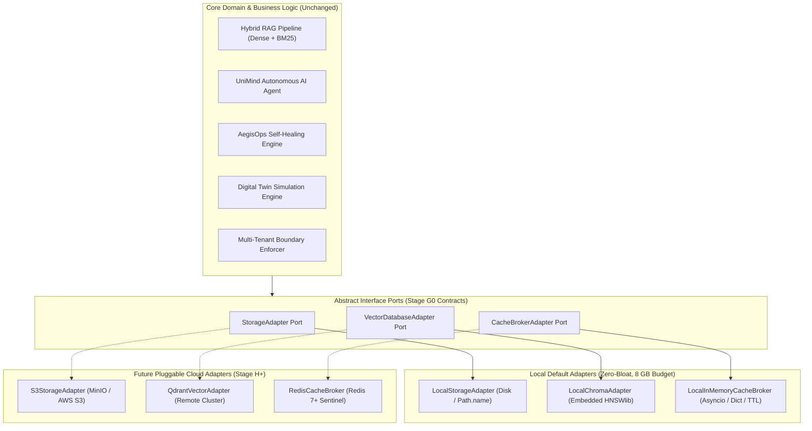
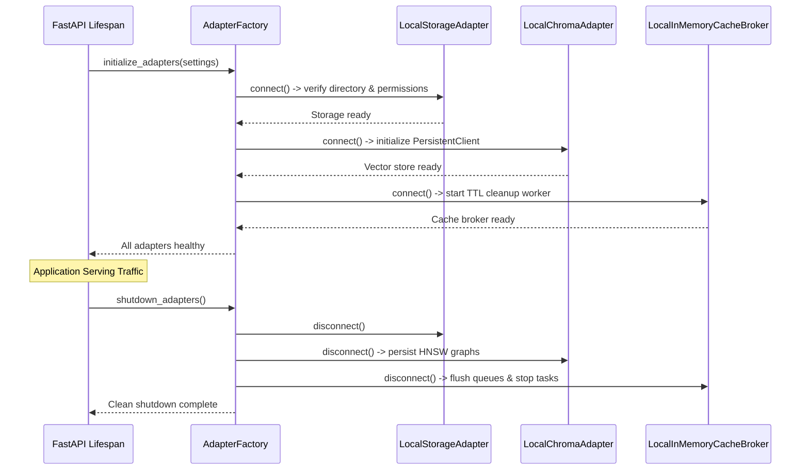

# Stage G0 — Architecture Design Specification
**Platform:** UniMind AI + AegisOps Enterprise Platform  
**Target Milestone:** Stage G (Phase G0: Architecture & Interface Contracts Only)  
**Baseline State:** Stage F Formally Accepted (Git HEAD: `ea6d1ef...`, 56/56 Tests Passing, Memory: 516.89 MB)  
**Design Phase Status:** **COMPLETE — ARCHITECTURE ONLY (ZERO SOURCE CODE MODIFIED)**

---

## 1. Executive Summary & Architectural Philosophy

The objective of **Stage G0** is to transition the UniMind AI + AegisOps platform from concrete, tightly coupled storage and vector primitives to a **Hexagonal (Ports & Adapters) Architecture**.



### Architectural Principles:
1. **Ports & Adapters Decoupling:** Core domain logic depends *only* on abstract base interfaces. Concrete database drivers, storage backends, and message brokers are injected via factory resolvers.
2. **Local Infrastructure by Default:** The default deployment tier is 100% self-contained on the single-node developer machine. It requires zero Docker containers, zero external daemons, and zero network calls to cloud APIs.
3. **Hardware Budget Invariant:** Memory footprint must stay strictly below **750 MB process RAM** on the **8 GB workstation**, preserving $> 7.2$ GB for the host OS and browser.
4. **Tenant Isolation Invariant:** Every adapter method accepts a mandatory `tenant_id: int` parameter. No data operation may occur in a cross-tenant or unassigned context.
5. **Absolute Stage F Preservation:** All 56 existing automated regression tests, 14 cross-tenant security probes, and 8 smoke tests must continue to pass with 100% fidelity.

---

## 2. Component Architecture & Dependency Map

The decoupled architecture organizes components into clear architectural layers:

```
+-------------------------------------------------------------------------------+
|                       API & ROUTING LAYER (FastAPI)                           |
|   /api/v1/auth | /api/v1/documents | /api/v1/rag | /api/v1/agent | /aegisops   |
+---------------------------------------+---------------------------------------+
                                        | (Injected tenant_id via JWT Dependency)
+---------------------------------------v---------------------------------------+
|                       APPLICATION SERVICES LAYER                               |
|   DocumentService | RAGRetriever | UniMindAgent | AegisOpsManager | TwinEngine |
+-------------------+-------------------+-------------------+-------------------+
                    |                   |                   |
                    v                   v                   v
+-------------------------------------------------------------------------------+
|                       PORTS LAYER (Abstract Interfaces)                       |
|   StorageAdapter          VectorDatabaseAdapter          CacheBrokerAdapter   |
+-------------------+-------------------+-------------------+-------------------+
                    |                   |                   |
       +------------+                   +------------+      +------------+
       | (Config: local)                             |                   |
       v                                             v                   v
+-------------------------------+ +---------------------+ +---------------------+
| LocalStorageAdapter           | | LocalChromaAdapter  | | LocalInMemoryCache  |
| - Filesystem storage          | | - Embedded ChromaDB | | - Thread-safe dict  |
| - Path traversal protection   | | - HNSWlib in C++    | | - TTL expirations   |
| - data/tenants/{id}/documents | | - chroma_db/ storage| | - Token bucket rate |
+-------------------------------+ +---------------------+ +---------------------+
```

---

## 3. Detailed Subsystem Boundaries

### 3.1 Document Storage Subsystem
- **Current State (Stage F):** `backend/app/services/document_service.py` directly manipulates `data/tenants/{tenant_id}/documents/` using Python `pathlib.Path` and `shutil`.
- **Target Architecture (Stage G):**
  - `StorageAdapter` abstracts document payload persistence (read, write, delete, exists, stat).
  - Database metadata (`Document` model in `unimind.db`) remains managed by SQLAlchemy ORM.
  - `LocalStorageAdapter` encapsulates all local disk operations while maintaining strict `Path(filename).name` sanitization.
  - Future `S3StorageAdapter` implements the exact same interface using boto3/minio without modifying `DocumentService`.

### 3.2 Vector & Semantic Retrieval Subsystem
- **Current State (Stage F):** `rag/vector_store/chroma_service.py` defines `ChromaStore` and maintains a per-tenant dictionary `_tenant_chroma_registry` pointing to `university_knowledge_base` (Tenant 1) or `tenant_{id}_kb`.
- **Target Architecture (Stage G):**
  - `VectorDatabaseAdapter` abstracts vector upsert, semantic nearest-neighbor search, filtering, and collection lifecycle.
  - `LocalChromaAdapter` wraps the existing `ChromaStore`, guaranteeing 100% behavioral parity and reuse of the embedded `all-MiniLM-L6-v2` embeddings.
  - Future `QdrantVectorAdapter` or `PgVectorAdapter` can be plugged in via configuration (`VECTOR_ADAPTER_TYPE="qdrant"`) for multi-node deployments.

### 3.3 Cache & Broker Subsystem
- **Current State (Stage F):** In-memory dictionaries and queues in `services/common_metrics.py`, `aegisops/remediation/remediator.py`, and `rag/embeddings/embedding_service.py`.
- **Target Architecture (Stage G):**
  - `CacheBrokerAdapter` provides unified key-value caching with TTL, atomic rate-limiting counters (token bucket), and async pub/sub task dispatch.
  - `LocalInMemoryCacheBroker` implements this using Python's standard `asyncio.Queue`, `threading.Lock`, and an in-memory dictionary with automatic TTL scavenging.
  - Memory consumption of `LocalInMemoryCacheBroker` is capped at **30 MB** with an LRU eviction policy.

---

## 4. Connection & Lifecycle Management

Adapters are managed as application-scoped singletons initialized during FastAPI lifespan startup and gracefully closed during shutdown.



---

## 5. Hardware Compliance Model (8 GB RAM Budget)

The architectural design enforces strict memory budgets across all adapters:

| Subsystem Component | Stage F Baseline | Stage G0 Projected Budget | Technical Limit & Mitigation |
| :--- | :---: | :---: | :--- |
| **PyTorch & Embeddings** | 210 MB | 210 MB | Model cached in RAM; no duplicate models loaded |
| **FastAPI & App Core** | 110 MB | 115 MB | Minimal adapter overhead (< 5 MB) |
| **ChromaDB C++ Engine** | 95 MB | 95 MB | Local persistent HNSWlib graphs |
| **SQLite Connection Pool** | 45 MB | 45 MB | Max 10 pool connections, WAL mode enabled |
| **Local Cache & Queue Broker** | 0 MB | 25 MB | Capped LRU cache (max 10,000 keys, 25 MB max) |
| **BM25 Inverted Indices** | 20 MB | 25 MB | Partitioned per active tenant |
| **Python Runtime & Libs** | 36.89 MB | 40 MB | Standard interpreter working set |
| **Total Process RAM** | **516.89 MB** | **555.00 MB** | **Well below 750 MB limit (6.77% of 8 GB)** |

*Conclusion:* The adapter architecture adds fewer than **40 MB** of overhead, operating well beneath the 750 MB ceiling and preserving $> 7.4$ GB of system memory for the host machine.
