# Stage G0 — Implementation Roadmap & Execution Gates (G1 – G5)
**Platform:** UniMind AI + AegisOps Enterprise Platform  
**Target Milestone:** Stage G (Phases G1 through G5)  
**Baseline State:** Stage F Formally Accepted (Git HEAD: `ea6d1ef...`)  
**Design Phase Status:** **COMPLETE — ARCHITECTURE ONLY (ZERO SOURCE CODE MODIFIED)**

---

## 1. Phased Execution Roadmap

The implementation of Stage G is structured into five sequential, gated phases following the approval of Phase G0.

```mermaid
flowchart LR
    G0["Phase G0: Architecture Design (CURRENT)"] -->|Gate 0: User Approval| G1["Phase G1: Adapters & Quota Enforcement"]
    G1 -->|Gate 1: Contract Tests Pass| G2["Phase G2: Closed-Loop Digital Twin & AegisOps"]
    G2 -->|Gate 2: Autonomous Playbooks Verified| G3["Phase G3: Observability & Prometheus"]
    G3 -->|Gate 3: Health & Metrics Verified| G4["Phase G4: Enterprise Governance UI"]
    G4 -->|Gate 4: 0 Build Errors| G5["Phase G5: Final Verification & Sign-Off"]
```



---

## 2. Phase-by-Phase Breakdown & Milestone Gates

### Phase G1 — Pluggable Adapter Core Implementation & Tenant Quota Enforcement
- **Scope:**
  - Create `backend/app/adapters/` package containing `StorageAdapter`, `VectorDatabaseAdapter`, and `CacheBrokerAdapter`.
  - Implement `LocalStorageAdapter`, `LocalChromaAdapter`, and `LocalInMemoryCacheBroker`.
  - Refactor `document_service.py` and `retriever.py` to route through adapters.
  - Implement token-bucket rate limiter middleware (`HTTP 429`) and storage quota checks (`HTTP 413`).
- **Entry Criteria:** Explicit user authorization of Phase G0 deliverables.
- **Exit Criteria (Gate 1):** Level 1 contract tests pass; Level 2 subsystem tests pass; rate limiting verified; zero regressions on existing 56 tests.

### Phase G2 — Closed-Loop Digital Twin & AegisOps Operational Convergence
- **Scope:**
  - Implement telemetry event dispatcher bridging `DigitalTwinSimulationEngine` with `AegisOpsIncidentManager`.
  - Define predictive incident types (`PREDICTIVE_ENERGY_ANOMALY`, `PREDICTED_CAPACITY_EXHAUSTION`).
  - Implement human-in-the-loop remediation approval workflow (`POST /api/v1/aegisops/remediations/{id}/approve`).
- **Entry Criteria:** Gate 1 passed.
- **Exit Criteria (Gate 2):** Simulated campus energy surge automatically creates AegisOps incident; action requires administrator JWT approval; recovery verified.

### Phase G3 — Production Observability, Prometheus Metrics & Health Probing
- **Scope:**
  - Expose `/metrics` endpoint using `prometheus-client` with RED metrics (Rate, Errors, Duration).
  - Expose standardized Kubernetes health probes (`/health/live`, `/health/ready`).
  - Implement audit log exporter supporting tenant-filtered JSON-Lines and CSV streaming.
- **Entry Criteria:** Gate 2 passed.
- **Exit Criteria (Gate 3):** Prometheus scraping returns valid OpenMetrics; health endpoints return HTTP 200; audit export passes cross-tenant isolation.

### Phase G4 — Frontend Enterprise Governance Dashboard
- **Scope:**
  - Update `frontend/src/` to include Tenant Quota Management sliders and gauges.
  - Add Prometheus health monitoring panel.
  - Add Audit Log Export download button with date-range picker.
- **Entry Criteria:** Gate 3 passed.
- **Exit Criteria (Gate 4):** Frontend production build completes in $< 30$s with 0 TypeScript/JSX errors.

### Phase G5 — Comprehensive Verification & Milestone Sign-Off
- **Scope:**
  - Run full automated regression suite ($\ge 70$ tests).
  - Run expanded cross-tenant security suite (16 probes).
  - Verify Isolation Forest model hash (`c271522...`) and SQLite integrity.
  - Measure peak memory footprint on 8 GB machine ($< 750$ MB).
  - Deliver consolidated Stage G verification reports.
- **Entry Criteria:** Gate 4 passed.
- **Exit Criteria (Gate 5):** 100% test pass rate, formal customer sign-off.

---

## 3. Critical Path & Dependency Matrix

```
[Phase G0] Architecture Contracts
    │
    ▼
[Phase G1] Adapter Core & Quota Engine ───► [Phase G3] Observability & Metrics
    │                                              │
    ▼                                              ▼
[Phase G2] Closed-Loop Twin & AegisOps ───► [Phase G4] Governance UI
                                                   │
                                                   ▼
                                            [Phase G5] Final Verification
```

---

## 4. Hardware Budget & Risk Register

| Risk Event | Severity | Mitigation Strategy | Owner |
| :--- | :---: | :--- | :---: |
| **Process memory exceeds 750 MB** | High | Capped LRU cache (25 MB max); single ONNX/PyTorch model instance | Adapters Lead |
| **Adapter refactoring breaks RAG retrieval** | Critical | Wraps existing `ChromaStore` directly; Level 2 tests run before committing | RAG Lead |
| **Rate limiter introduces high latency** | Medium | In-memory token bucket evaluates in $< 0.5$ ms using integer arithmetic | Backend Lead |
| **Actuators execute without approval** | Critical | Status defaulted to `PENDING_APPROVAL`; execute requires admin JWT | Security Lead |

---

> [!IMPORTANT]
> **Implementation Standby:**
> In accordance with strict development rules, **Phase G1 will NOT begin** until this Phase G0 design package is thoroughly reviewed and authorized by the user.
