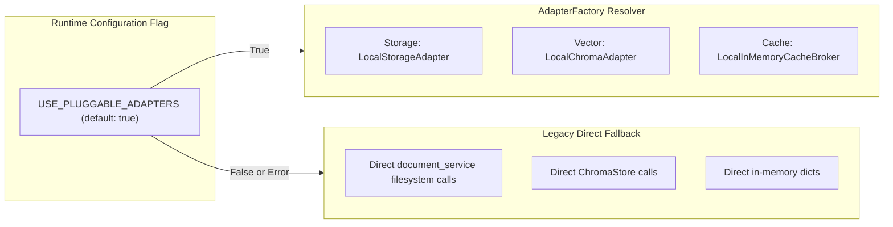

# Stage G0 — Migration Strategy & Safe Rollback Plan
**Platform:** UniMind AI + AegisOps Enterprise Platform  
**Target Milestone:** Stage G (Phase G0: Architecture & Interface Contracts Only)  
**Baseline State:** Stage F Formally Accepted (Git HEAD: `ea6d1ef...`)  
**Design Phase Status:** **COMPLETE — ARCHITECTURE ONLY (ZERO SOURCE CODE MODIFIED)**

---

## 1. Migration Overview & Non-Breaking Guarantees

The transition to the Stage G adapter architecture requires **zero database schema migrations** and **zero data format conversions** for the single-node local deployment tier.

The existing files, database records, and vector indices will remain exactly where they are:
- Documents: `data/tenants/{tenant_id}/documents/`
- SQLite Database: `unimind.db`
- ChromaDB Indices: `chroma_db/`
- ML Models: `ml/models/isolation_forest.joblib`



---

## 2. Adapter Factory & Dynamic Resolver Strategy

Adapters are resolved at application boot via an `AdapterFactory` registry configured through environment variables with safe, local defaults:

```python
# Configuration Settings (backend/app/core/config.py)
STORAGE_ADAPTER_TYPE: str = "local"     # Options: "local", "s3"
VECTOR_ADAPTER_TYPE: str = "chroma"     # Options: "chroma", "qdrant", "pgvector"
CACHE_ADAPTER_TYPE: str = "memory"      # Options: "memory", "redis"
USE_ADAPTER_FALLBACK: bool = True       # Automatic fallback to legacy on adapter failure
```

### Dependency Injection Pattern
FastAPI routes and application services inject adapters via standard FastAPI dependencies:

```python
def get_storage_adapter() -> StorageAdapter:
    return AdapterFactory.get_storage()

def get_vector_adapter(tenant_id: int = 1) -> VectorDatabaseAdapter:
    return AdapterFactory.get_vector(tenant_id)

def get_cache_broker() -> CacheBrokerAdapter:
    return AdapterFactory.get_cache()
```

---

## 3. Safe Rollback Procedures

If any defect, unexpected latency spike, or tenant isolation anomaly occurs during the Phase G1 implementation:

### 3.1 Instant Configuration Rollback (Zero Code Change)
Setting `USE_ADAPTER_FALLBACK = True` or toggling the configuration flags reverts the system immediately to the legacy Stage F direct code paths. No application restart is required if using dynamic settings reload.

### 3.2 Git-Level Rollback
Because Stage G0 modifies zero application files and Stage F is permanently locked in [STAGE_F_BASELINE_MANIFEST.json](file:///c:/Users/kartik/Documents/unimind-ai/docs/stage_f_acceptance/STAGE_F_BASELINE_MANIFEST.json), the entire project can be reverted to the Stage F baseline with:
```powershell
git checkout ea6d1efc120f15e38d1fd2852a0964d0d62e3c3d
```

### 3.3 Data State Protection
Since local adapters write directly to existing file structures without altering binary schemas, rolling back the code leaves all ingested documents, embeddings, and database rows 100% accessible to the legacy code.

---

## 4. Future Cloud Backend Migration Procedures (Stage H+ Reference)

When external distributed infrastructure is authorized in future enterprise milestones, the following non-disruptive migration scripts will be provided:

### 4.1 SQLite to PostgreSQL Migration
1. Set database connection to read-only WAL mode.
2. Run `scripts/migrate_sqlite_to_postgres.py` using SQLAlchemy reflection.
3. Validate row counts, primary key sequences, and tenant foreign keys.
4. Update `DATABASE_URL` in `.env` to `postgresql://...`.

### 4.2 Local ChromaDB to Distributed Qdrant Migration
1. Run `scripts/export_chroma_to_qdrant.py`.
2. Extract chunks and embeddings per tenant collection.
3. Batch upload points into Qdrant collections with tenant payloads (`{"tenant_id": tid}`).
4. Verify semantic search parity and latency benchmarks.

### 4.3 Local Filesystem to S3/MinIO Migration
1. Run `scripts/sync_documents_to_s3.py`.
2. Upload `data/tenants/{id}/documents/` to `s3://unimind-{id}-documents/`.
3. Set `STORAGE_ADAPTER_TYPE="s3"` and verify presigned download URLs.
