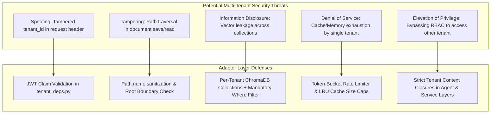

# Stage G0 — Security Impact & Multi-Tenant Threat Assessment
**Platform:** UniMind AI + AegisOps Enterprise Platform  
**Target Milestone:** Stage G (Phase G0: Architecture & Interface Contracts Only)  
**Security Standard:** Defense-in-Depth Multi-Tenant Boundary Protection  
**Design Phase Status:** **COMPLETE — ARCHITECTURE ONLY (ZERO SOURCE CODE MODIFIED)**

---

## 1. Security Architecture Overview & Invariants

The Stage G adapter architecture maintains the strict tenant isolation proven and accepted during Stage F.

Introducing interface abstractions must **never** weaken tenant boundaries or create bypass opportunities. The architecture establishes three non-negotiable **Tenant Isolation Invariants**:

```
+-------------------------------------------------------------------------------+
|                       TENANT ISOLATION INVARIANTS                             |
+-------------------------------------------------------------------------------+
| Invariant 1 (Mandatory Parameter): Every adapter method requires tenant_id.   |
| Invariant 2 (No Cross-Tenant Calls): Requesting tenant_id != Auth tenant_id   |
|                                      triggers TenantIsolationViolationError.  |
| Invariant 3 (Cryptographic Defense): Keys, collections, and file paths are    |
|                                      prefixed with the tenant's namespace.    |
+-------------------------------------------------------------------------------+
```

---

## 2. STRIDE Threat Model & Adapter Defenses

Each port and adapter was evaluated against the STRIDE threat model:



### Detailed STRIDE Threat Mitigation Analysis

| Threat Category | Specific Attack Vector | Affected Port / Subsystem | Stage G Adapter Countermeasure |
| :--- | :--- | :--- | :--- |
| **Spoofing** | Attacker crafts API request with another tenant's `tenant_id` | All Adapters | FastApi dependency `get_current_tenant` extracts `tenant_id` directly from cryptographically signed JWT. Adapter verifies caller matches JWT context. |
| **Tampering** | Uploading `../../confidential.pdf` to escape tenant directory | `StorageAdapter` | `LocalStorageAdapter` strips path components with `Path(filename).name` and verifies `resolved_path.is_relative_to(tenant_root)`. |
| **Information Disclosure** | ChromaDB nearest-neighbor search retrieves adjacent tenant chunk | `VectorDatabaseAdapter` | 1. Dedicated collection per tenant (`tenant_{id}_kb`).<br>2. Explicit query filter `where={"tenant_id": {"$eq": tid}}`. |
| **Information Disclosure** | Cache key collision or snooping between tenants | `CacheBrokerAdapter` | All cache keys are strictly prefixed as `f"tenant:{tenant_id}:{key}"`. Global key listing is disallowed. |
| **Denial of Service** | Rogue tenant floods cache or vector store | `CacheBrokerAdapter` / `StorageAdapter` | Token-bucket rate limiting rejects excess calls with `HTTP 429`. Tenant storage quotas reject oversized uploads with `HTTP 413`. |
| **Elevation of Privilege** | Agent tool invoked in Tenant A queries documents in Tenant B | `UniMindAgent` / Tools | Agent tools execute inside dynamic closures where `tenant_id` is locked to the authenticated user. |

---

## 3. Defense-in-Depth Implementation Details

### 3.1 StorageAdapter Defense-in-Depth
```python
def _sanitize_path(self, tenant_id: int, category: str, filename: str) -> Path:
    # Rule 1: Strip directory traversal characters
    safe_name = Path(filename).name
    if not safe_name or safe_name in (".", ".."):
        raise TenantIsolationViolationError("Invalid or illegal filename", tenant_id=tenant_id)
        
    # Rule 2: Resolve absolute tenant root
    tenant_root = (self.base_dir / "tenants" / str(tenant_id) / "documents" / category).resolve()
    target_path = (tenant_root / safe_name).resolve()
    
    # Rule 3: Enforce jail boundary check
    if not str(target_path).startswith(str(tenant_root)):
        raise TenantIsolationViolationError("Path traversal attempt detected", tenant_id=tenant_id)
        
    return target_path
```

### 3.2 VectorDatabaseAdapter Defense-in-Depth
- **Double-Lock Architecture:**
  - *Lock 1 (Physical Partition):* Tenant 1 uses `"university_knowledge_base"`; Tenant 2+ uses `"tenant_{id}_kb"`.
  - *Lock 2 (Logical Metadata Filter):* Even within a collection, every query executes with `where={"tenant_id": {"$eq": tenant_id}}`.

### 3.3 CacheBrokerAdapter Defense-in-Depth
- **Namespace Enclosure:**
  ```python
  def _get_namespaced_key(self, tenant_id: int, key: str) -> str:
      if tenant_id <= 0:
          raise TenantIsolationViolationError("Tenant ID must be positive integer", tenant_id=tenant_id)
      # Prevent namespace escape via delimiter injection
      clean_key = key.replace("\r", "").replace("\n", "").replace(":", "_")
      return f"tenant:{tenant_id}:{clean_key}"
  ```

---

## 4. Audit Logging & Non-Repudiation

Every adapter mutation (`save_file`, `delete_file`, `upsert_chunks`, `delete_tenant_collection`) logs a structured audit event to the existing `audit_logs` table in `unimind.db` recording:
- `timestamp`: UTC ISO-8601 timestamp.
- `tenant_id`: Authenticated tenant ID.
- `user_id`: Authenticated user ID (if available).
- `action`: E.g., `STORAGE_SAVE_DOCUMENT`, `VECTOR_UPSERT_CHUNKS`.
- `resource_id`: Storage path or document ID.
- `ip_address`: Client remote IP.
