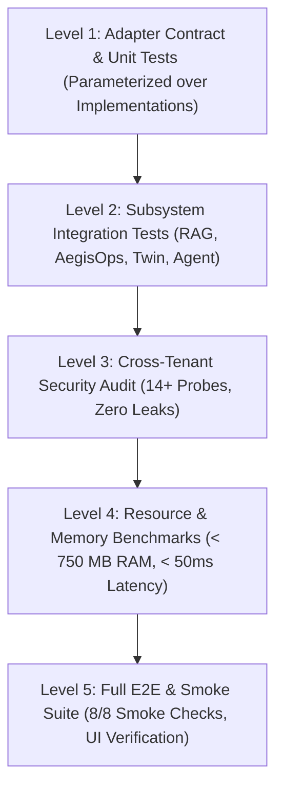

# Stage G0 — Test Strategy & Non-Regression Framework
**Platform:** UniMind AI + AegisOps Enterprise Platform  
**Target Milestone:** Stage G (Phase G0: Architecture & Interface Contracts Only)  
**Baseline Test Suite:** 56/56 Tests Passing, 14 Security Probes Passing  
**Design Phase Status:** **COMPLETE — ARCHITECTURE ONLY (ZERO SOURCE CODE MODIFIED)**

---

## 1. Test Strategy Overview & Verification Pyramid

The Stage G testing strategy is structured around a **5-Level Verification Pyramid** to guarantee that introducing pluggable adapters causes zero regression in existing capabilities.

---

## 2. Test Level Specifications

### Level 1: Adapter Contract Compliance Tests
- **Location:** `tests/adapters/test_adapter_contracts.py` (to be authored in Phase G1).
- **Methodology:** Parameterized test suite using `@pytest.mark.parametrize("adapter_cls", [...])`.
- **Test Cases:**
  1. `test_storage_adapter_save_and_read`: Writes binary content, reads back byte-for-byte, asserts cryptographic SHA-256 match.
  2. `test_storage_adapter_path_traversal_denial`: Attempts saving with `../../evil.pdf`, asserts `TenantIsolationViolationError`.
  3. `test_vector_adapter_upsert_and_query`: Upserts chunks with embeddings, queries nearest neighbors, asserts similarity score.
  4. `test_vector_adapter_tenant_isolation`: Queries Tenant 1 vector store for Tenant 2 chunks, asserts 0 chunks returned.
  5. `test_cache_broker_ttl_expiration`: Sets key with TTL=1s, sleeps 1.1s, asserts `get()` returns `None`.
  6. `test_cache_broker_rate_limiting`: Generates $N+1$ requests against limit $N$, asserts `allowed=False` on $(N+1)$-th request.

### Level 2: Subsystem Integration Tests
- **Location:** `tests/test_document_service_adapters.py`, `tests/test_rag_adapters.py`.
- **Methodology:** Executes core business logic (`DocumentService.upload_document`, `RAGRetriever.query`) backed by `LocalStorageAdapter` and `LocalChromaAdapter`.
- **Assertions:**
  - Database row creation succeeds with correct `tenant_id`.
  - BM25 and vector store remain fully synchronized.
  - Hybrid RAG reciprocal rank fusion (RRF) produces identical top-ranked chunks.

### Level 3: Cross-Tenant Security Audit (Expanding to 16 Probes)
- **Location:** `scripts/verify_cross_tenant_security.py`.
- **Existing Probes Verified:** All 14 existing check blocks must pass with 100% fidelity.
- **New Probes for Stage G:**
  - *Probe 15 (Cache Namespace Isolation):* Tenant 1 writing key `"session_token"` cannot be read or overwritten by Tenant 2.
  - *Probe 16 (Tenant Rate Limit Partitioning):* Tenant 1 exhausting their rate limit does not degrade or block Tenant 2's request allowance.

### Level 4: Performance & Hardware Constraint Verification
- **Location:** `scripts/measure_resource_footprint.py`.
- **Metrics Enforced:**
  - Peak Working Set Process RAM: $< 750$ MB (host: 8 GB RAM).
  - Hybrid RAG warm retrieval latency: $< 50$ ms.
  - Cache broker get/set latency: $< 1.0$ ms.
  - Rate limiting check latency: $< 0.5$ ms.

### Level 5: Full Application Smoke Test & Production Build
- **Location:** `scripts/smoke_test_preservation.py` and `npm run build`.
- **Verifications:**
  - Backend startup and root `/` and `/health` endpoints return HTTP 200.
  - React + Vite production build compiles with 0 errors across all 1,490+ modules.
  - Live agent decision turn executes and cites grounded documents.

---

## 3. Test Fixture & Mocking Policy

To respect the user's constraints:
1. **Zero External Daemons in Tests:** Tests must **not** require Redis, PostgreSQL, or cloud services.
2. **Ephemeral Test SQLite & Chroma:** Integration tests will use temporary SQLite databases (`sqlite:///:memory:` or ephemeral `.tmp/test.db`) and temporary Chroma persist directories (`.tmp/test_chroma/`) that clean up on teardown.
3. **Deterministic Embeddings for Fast Testing:** Unit tests will utilize deterministic 384-dimensional test vectors when running without GPU, running full MiniLM embeddings only in benchmark suites.

---

## 4. Non-Regression Acceptance Criteria

| Subsystem | Stage F Baseline | Stage G Target | Minimum Threshold |
| :--- | :---: | :---: | :---: |
| **Pytest Pass Rate** | 56 / 56 (100%) | $\ge 70$ / 70 (100%) | **100% (Zero Skips)** |
| **Security Probes** | 14 / 14 (100%) | 16 / 16 (100%) | **100% (Zero Leaks)** |
| **Process RAM (Peak)**| 516.89 MB | $\le 575$ MB | **< 750 MB** |
| **Warm RAG Latency** | 29.98 ms | $\le 35.00$ ms | **< 200 ms** |
| **Anomaly Scoring** | 13.49 ms | $\le 15.00$ ms | **< 50 ms** |
| **Vite Frontend Build**| 0 Errors, 24.63s | 0 Errors, < 30.00s | **0 Errors** |
